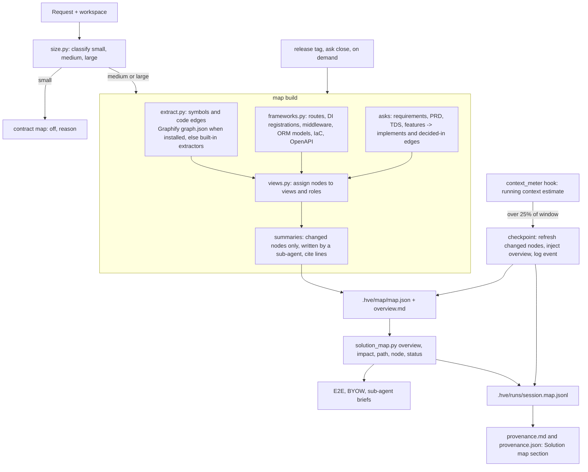

<!-- hve-document: {"kind": "technicalDesign", "sha256": "153f72ea2af41bad985e5e58a3e7d3b3cc8cd4d3f5a29725fa56dce348f49b73", "slug": "solution-map", "source": "builtin:technical-design@1"} -->
<!-- hve-template: technicalDesign@1 -->
# Technical Design Specification

<!-- hve-section: context -->
## Context and Requirements

**System:** Frontier HVE solution map (working name), a layered, meaning-carrying graph of an application that agents read instead of re-exploring the repository. **Owner:** muralim-ai2. **Status:** draft for review, 2026-10-22; nothing built. **Linked PRD:** none; the requirements below come from the user's request of 2026-10-22 and the Graphify review the same day (decision D-016, findings `phase-3-tokenomics.md`).

**Problem.** A new chat on an existing AI-built app spends most of its first turns re-reading the repository to learn how it fits together, and does so again in every session. Graphify, the current code graph, does not solve this: it is wired only to the research `creator` agent, its graph holds the colour-palette benchmark (195 nodes), it extracts syntax only (files, functions, calls, imports), answers by label match ("No matching nodes" for a plain-language question), has no layers, summaries or owners, and was never measured with and without (1 query in the baseline run).

**Goal.** For medium and large apps, give every session a compact map from paradigm to module to symbol, with a one-line purpose per node, typed relationships and the expertise each part needs, so that the agent (a) knows where to start a feature and what it touches, (b) can tell the user which experts to involve, and (c) spends fewer tokens. Every claim of saving is measured and shown in the provenance report.

**Token hypothesis (to be measured, not assumed).** Session-start exploration of a mid-size app (15-40 files read, roughly 25-60k prompt tokens, repeated per session) would drop to roughly 10-15k (map overview 2-3k, impact result 1-2k, 3-6 targeted files). These figures are estimates from typical file sizes; this design exists partly to measure them.

| Id | Requirement |
|---|---|
| FR-1 | Classify each ask's app as small, medium or large from the workspace and the request; build and use the map only for medium and large, recorded as a flag in the contract and shown in `plan.md`. |
| FR-2 | Build a layered map: system, views (requirements, solution design, stack design, frontend, API/backend, middleware, data, identity, integration/APIM, infra/DevOps, observability, ML), modules, symbols. |
| FR-3 | Each node carries a one-to-two-line purpose and usage note, its interface, source paths with line ranges, the expertise role that owns it, and the commit it was taken from. |
| FR-4 | Edges carry the nature of the relationship: calls, imports, injects, routes-through, authenticates-with, reads, writes, exposes, consumes, deploys-to, configured-by, implements, decided-in, tested-by, owned-by. |
| FR-5 | Answer `overview`, `impact "<feature>"` (touchpoints, start point, dependency chain, roles to involve), `path <a> <b>`, `node <id>` and `status` (staleness) within a token budget. |
| FR-6 | Refresh on demand, on a release tag, when an ask closes, and when the session's context passes 25% of the model's context window (the compaction checkpoint). |
| FR-7 | At every checkpoint record the context size, the map refresh, and the tokens the map answers replaced; the provenance report shows them per session and per ask. |
| FR-8 | Route impact results to expertise packs (a data and APIM impact offers the matching packs) and name the roles to involve. |
| FR-9 | An explorer for people: one offline HTML page with three drawings of the same map (force diagram coloured by concept or view and sized by connections, collapsible tree, zoomable circle packing), opened at two levels and expanded interactively; grouped by Concepts (concept › modules › files › functions) or Architecture (system › views › modules › files › functions); filtered by the concept list, fuzzy search or a Cypher-subset query, with a visible filter banner, Back and Show whole map. |
| FR-10 | Concepts: named, explained areas of the code (for example agents, skills, packs, telemetry) with their member files, start file and questions; answered in chat by `explain` and the `solution-map` skill as concept, modules, files, functions, connections, dependencies and explanation. |
| FR-11 | Works on any repository: no repository-specific code in the builder; everything specific lives in an optional config file. |
| NFR-1 | Code facts are extracted without an LLM and without network calls; only node summaries use the session's own model, and only for nodes whose content hash changed. |
| NFR-2 | A stale map is never presented as current: every answer states the map's commit and how many mapped files changed since. |
| NFR-3 | `overview` stays under 4,000 tokens and `impact` under 2,000 tokens by default. |
| NFR-4 | No new runtime dependency is required; Graphify is used for the symbol layer when it is installed. |
| NFR-5 | Python modules stay under 500 lines, fail fast, and follow the repository code style. |
| AC-1 | On a medium sample app, `impact` lists the touched views, modules and roles for a new authenticated API endpoint, and each item cites a source path. |
| AC-2 | A session that passes 25% of its window writes a checkpoint event and the provenance report shows it with tokens before and after. |
| AC-3 | A with/without-map benchmark on the same model and task reports prompt tokens to the first correct change, files read and the check result. |
| AC-4 | A small app (below the thresholds) records `map: off` with the reason and builds nothing. |

<!-- hve-section: constraints -->
## Constraints and Assumptions

**Confirmed:**
- Agents run in VS Code Copilot Chat (Local harness, agent-scoped hooks) and are exported to other harnesses; hooks cannot rewrite chat history (D-013) and cannot trigger compaction. They can add context on `UserPromptSubmit`, `PreToolUse`, `PostToolUse` and `SubagentStart`, and `PreCompact` is notification only, with `trigger: "auto"` when the conversation exceeds the prompt budget (VS Code Local hooks reference; GitHub Copilot hooks reference).
- Hook payloads do not carry the context size. Measured prompt tokens exist only in metrics rows (research arms) or the Copilot OTel export when research telemetry is on (`ask_report.measures`).
- `.hve/` holds workspace state and is usually git-ignored; asks already record requests, features, stages, PRDs and designs (`contract.json`, `feature_list.json`, template registry).
- Graphify (`graphifyy` 0.9.71) extracts a code-only graph locally with tree-sitter (D-016) but must be installed separately with `uv`; extension users usually do not have it.
- The skill loader, compaction hook and provenance report already exist and are the places to add map context and evidence.

**Assumptions (unverified):**
- A-1: The model's context window can be read from a per-model table kept in `skills/categories.json` (`context_load`), defaulting to its first reference window (128,000) when the model is unknown; 25% is therefore 32,000 tokens by default.
- A-2: A running estimate of the session's context (prompts, tool inputs and results seen by hooks, plus the measured always-on load) is within about 20% of the real prompt size; the estimate is calibrated against OTel when telemetry is on.
- A-3: The session's model writes adequate one-line summaries when given the node's source lines; summaries cite their lines so a reviewer can check them.
- A-4: Thresholds for medium (50 source files or 5,000 lines) and large (300 files or 50,000 lines) are a reasonable starting point and are tuned from measurements.

<!-- hve-section: architecture -->
## Architecture and Components



| Component | Responsibility | Depends on |
|---|---|---|
| `tools/map/extract.py` (built) | Language-neutral code facts for any repository: tracked files (git, else a folder walk) minus dependencies and build output; purposes from docstrings, header comments, front matter, README and headings; symbols from Python `ast` and line-anchored patterns for JS/TS, C#, Java and Go; imports; file-name mentions; agent hooks and agent references; decision logs (`## D-001`) and ADR files | none |
| `tools/map/map_build.py` (built) | Size class; placement into views and modules (the config's rules, else the top-level folder as view and the file's folder as module); typed edges with evidence (`imports`, `invokes`, `guarded-by`, `delegates-to`, `tested-by`, `documented-in`, `decided-in`, `uses`, `writes`, `includes`); concepts (configured, else one per view, marked derived); external dependencies (stdlib and local modules excluded); overview Markdown; the explorer page | extract |
| `docs/architecture/solution-map.config.json` (optional, per repository) | Everything repository-specific: `exclude`, `views` with roles, `modules` (path rules with names and purposes), `purposes` for files without one, `stores` (path marker, curated writers), `concepts` (`name`, `keywords`, `members` path rules, `start`, `explain`, `questions`), `conventions`, `flows`. A repository without it still gets a full map | written by people or proposed by the agent |
| `tools/map/solution_map.py` (built) | CLI: `build [--snapshot]`, `explain "<question>"` (Markdown or `--json`), `impact --seeds`, `search`, `overview`, `status`, `open [concept=…\|q=…]` | map_build |
| `hooks/context_meter.py` | Keep a running estimate of the session's context; at 25% of the window run the checkpoint once per crossing band (25%, 50%, 75%); log `PreCompact` events | session events |
| `tools/loop` additions | `size` and `map` flag in the contract, an `impact` step in the E2E and BYOW prompts, map lines in briefs, a Solution map section in the provenance report | solution_map |
| `tools/map/explorer/` (built) | `explorer.html`, `explorer.css`, `graph.js` (Concepts and Architecture hierarchies, filters, rolled-up links, search, concept cards), `query.js` (Cypher subset), `views.js` (force, collapsible tree, zoomable circle packing), `app.js` (controls, filter banner with Back and Show whole map, concept card, hash links `#concept=`, `#q=`, `#node=`, `#cypher=`). Inlined into one offline page | map.json |
| `plugins/harness-assist/skills/solution-map` (built) | Chat entry point in Copilot, Claude Code and Codex: asks before using the map unless invoked with `/solution-map`, refreshes a stale map, runs `explain`, answers as concept › modules › files › functions › connections › dependencies › start file, offers the filtered explorer or an impact check, proposes a new concept when none matches, and tells the user how to ask again. E2E, BYOW and HVE creator follow it when the user asks how code works | solution_map |

Principal flows:
1. **Contract:** `lifecycle.py contract` calls `size.classify`; medium or large sets `map.enabled` and, when the workspace has code, builds or refreshes the map before planning. A new project with a medium or large request builds its first map when the first milestone with code is done.
2. **Feature request in an existing app:** the agent reads `overview`, runs `impact "<feature>"`, shows touchpoints, start point and roles in the plan, and offers the packs and personas the impact names. It reads only the files the impact cites.
3. **Checkpoint:** when the estimate passes 25% of the window, `context_meter` refreshes changed nodes, adds the overview and the current task's impact to the context with a note that earlier exploration output can be dropped, and logs the event.
4. **Release:** a release tag (or `solution_map.py snapshot <name>`) writes an immutable snapshot; `diff` shows architecture drift between snapshots.

<!-- hve-section: data -->
## Data Design

**Map file** (`.hve/map/map.json`, one per workspace, JSON only):

```json
{
  "version": 1,
  "commit": "705f275",
  "built": "2026-10-22T18:00:00+00:00",
  "size": {"class": "medium", "files": 142, "lines": 18350, "views": ["frontend", "api", "data", "identity", "infra"], "why": ["142 source files", "5 views"]},
  "nodes": [
    {"id": "api:orders.create_order", "level": "symbol", "view": "api", "module": "api:orders", "kind": "endpoint",
     "name": "POST /orders", "purpose": "Creates an order for the signed-in customer and reserves stock.",
     "interface": "body OrderIn -> 201 OrderOut; 401, 409", "source": "src/api/orders.py:40-88", "role": "backend-engineer",
     "hash": "9f2c...", "summary_by": "session model, cites src/api/orders.py:40-88"}
  ],
  "edges": [
    {"from": "api:orders.create_order", "to": "middleware:auth.require_user", "type": "routes-through", "evidence": "src/api/orders.py:39"},
    {"from": "api:orders.create_order", "to": "data:orders_table", "type": "writes", "evidence": "src/repo/orders.py:22"},
    {"from": "req:FR-3", "to": "api:orders.create_order", "type": "implements", "evidence": "docs/product/PRD-shop.md#FR-3"}
  ],
  "files": {"src/api/orders.py": "sha256..."}
}
```

- **Levels:** `system`, `view`, `module`, `symbol`. Ids are `<view>:<module>[.<symbol>]`, stable across builds for unchanged code.
- **Every edge has evidence** (a source line or document anchor); edges without evidence are not written.
- **Roles** (`skills/map_roles.json`): view to roles, for example `data` to `db-engineer`, `infra` to `devops`, `identity` to `security`, `integration` to `platform-apim`, `ml` to `data-scientist`, `requirements` to `product-manager`. Expertise packs may add roles and views for their domain.
- **Snapshots:** `.hve/map/snapshots/<release-or-utc-stamp>.json`, never edited. A release snapshot is also written to `docs/architecture/solution-map.json` and `solution-map.md` and committed (Q-3).
- **Events** (`.hve/runs/<session>.map.jsonl`), one line per event: `{"ts", "event": "checkpoint"|"query"|"build"|"precompact", "context_estimate", "window", "share", "map_commit", "changed_files", "answer_tokens", "cited_file_tokens", "measured_prompt"}`.
- **Retention:** the map and snapshots stay with the workspace; events follow the `.hve/runs` retention. The map holds code structure and summaries, no secrets: files matched by `.gitignore` and secret patterns from `tools/skills/scan.py` are skipped.

<!-- hve-section: interfaces -->
## Interfaces and Contracts

**CLI** (`python <tools>/map/solution_map.py`, JSON or Markdown out, non-zero exit on error):

| Command | Returns |
|---|---|
| `size <request-file>` | `{class, files, lines, views, why}` |
| `build [--changed]` | Nodes and edges added, changed, removed; summaries pending |
| `summaries prepare` / `summaries record <file>` | A batch of changed nodes with their source lines for a sub-agent; records its summaries after checking each cites lines inside the node |
| `overview [--budget N]` | Views, modules with one-line purposes, state stores, conventions, key flows and roles, the map commit and staleness, within the budget (default 4,000) |
| `impact "<feature>" --seeds <ids> [--budget N]` | Touched views and modules, start point, dependency chain with edge types, roles to involve, packs to offer, files to read; within the budget (default 2,000) |
| `path <a> <b>`, `node <id>` | The typed path between two nodes; one node with its edges |
| `status` | Map commit, files changed since, nodes affected, whether a refresh is due |
| `snapshot <name>`, `diff <a> <b>` | Immutable snapshot; added, removed and changed nodes and edges between two snapshots |

**Contract additions** (`contract.json`): `map: {enabled, size, why, commit, path}`; the plan's generated block shows the size class, the map's age and staleness.

**Hook contract** (`context_meter.py`): on `UserPromptSubmit`, `PostToolUse` and `SubagentStart` it adds the text it saw to the session estimate (`.hve/runs/<session>.context.json`); when the estimate crosses a band (25%, then 50% and 75%) it runs `build --changed`, returns `additionalContext` with the overview and the current impact, and writes a `checkpoint` event. On `PreCompact` it writes a `precompact` event with the estimate. It never blocks a tool call.

**Agent contract:** E2E and BYOW read `overview` after `where` when `map.enabled`; for a feature on existing code they run `impact` before choosing the lifecycle and show touchpoints and roles in the plan; briefs carry the impact's files for the stage. Errors: a missing map when enabled builds it; a stale map is refreshed with `--changed` before use; extractor failures stop the build with the file and reason.

**Versioning:** `map.json` has `version: 1`; a breaking change rebuilds the map rather than migrating it.

<!-- hve-section: security -->
## Security and Access

- **No new network access:** extraction is local; summaries are written by the session's own model inside the chat, so no code leaves through a new channel.
- **Sensitive content:** the build skips `.gitignore`d files, `.env*`, key and certificate files, and lines matching the secret rules of `tools/skills/scan.py`; summaries describe behaviour and must not quote secrets.
- **Trust boundary:** the map is input to the model, not an authority: answers name their evidence lines, and the agent reads the cited file before editing it.
- **Access:** the map lives in the workspace with the same access as the code; committing a release snapshot to `docs/architecture/` was decided by the user (Q-3).
- **Prompt injection:** summaries are generated from code that may contain hostile comments; the `summaries record` step rejects summaries that contain instructions to the agent (the scan's prompt-injection rule) and keeps them as plain descriptive text.

<!-- hve-section: operations -->
## Reliability and Observability

**Failure modes:**

| Failure | Effect | Handling |
|---|---|---|
| Map stale (code changed since its commit) | Agent trusts old structure | Every answer states commit and changed files; checkpoint and ask close refresh with `--changed` |
| Context estimate wrong | Checkpoint too early or too late | Calibrated against OTel when telemetry is on; the event records estimate and measured value so the error is visible |
| Wrong summary | Agent starts in the wrong place | Summaries cite lines; the agent reads cited files before editing; reviewers can spot-check in `overview.md` |
| Extractor misses a framework convention | Missing edge | `status` lists modules with no inbound or outbound edges; packs can add conventions for their stack |
| Build too slow on large repos | Delay at contract or checkpoint | `--changed` hashes files and rebuilds only changed modules; full builds run on release or on demand |

**Performance budgets:** a changed-only refresh under 10 s for 50 changed files; `overview` under 4,000 tokens; `impact` under 2,000 tokens.

**Evidence of token saving (the point of FR-7):** the provenance report gets a **Solution map** section per session and ask:

| Measure | Source |
|---|---|
| Size class and why; map enabled or off | contract |
| Checkpoints: time, context estimate, share of window, files refreshed | `map.jsonl` checkpoint events |
| Compactions the harness ran (`PreCompact`) and the estimate at that moment | `map.jsonl` precompact events |
| Map answers: count and tokens | `map.jsonl` query events |
| Tokens of the files those answers cited (the reads the answer stands in for) | sum of cited files' tokens, an estimate labelled as such |
| Files actually read in the session, before and after the first map answer | skill loader and tool log |
| Measured prompt tokens: first, peak, at each checkpoint | metrics rows or OTel (research telemetry) |

The saving shown per session is an **estimate** (cited file tokens minus answer tokens). The **measurement** is the A/B benchmark (AC-3): the same model and task ("add an authenticated endpoint to an existing medium app") with the map on and off, comparing prompt tokens to the first correct change, files read and the check result, run through `tools/observe/bench.py` and reported in `research/comparisons/`.

<!-- hve-section: delivery -->
## Deployment and Rollback

**Rollout in milestones** (each ends with its tests and the user's review):
1. M1 Size flag: `size.py`, contract `map` field, plan line; no map yet. Shows how often asks are medium or large.
2. M2 Map build: generic extractors (Python `ast`, JS/TS imports and JSDoc, agent frontmatter, decisions, tests, docs, build lists), the placement file with views, modules, purposes and roles, `overview`, `node`, `status`. Framework conventions per stack come later (Q-4).
3. M3 Impact and agent use: `impact`, `path`, E2E and BYOW steps, briefs carrying cited files, pack routing from impact.
4. M4 Checkpoint and evidence: `context_meter` hook, events, provenance section.
5. M5 Measurement: the A/B benchmark on a medium sample app; the result decides whether the map becomes default for medium apps.
6. M6 Releases: snapshot on tag, `diff`, committed snapshot in `docs/architecture/`.
7. M7 Explorer: the HTML explorer from the prototype, a VS Code command that opens it in a webview, and a test that loads it headless and runs the example queries.

**Compatibility:** existing asks without a `map` field behave as `map: off`. The map is additive: no current flow depends on it.

**Rollback:** set `map.enabled` off in the contract (or remove the `context_meter` hook from an agent); the agents fall back to their current exploration. Deleting `.hve/map/` removes all state.

<!-- hve-section: alternatives -->
## Alternatives, Risks and Decisions

| Option | For | Against | Decision |
|---|---|---|---|
| Keep Graphify as is | Installed, local, no LLM | Syntax only, label search, creator-only, no evidence of saving | Rejected as the solution; kept as an optional symbol source |
| Graphify full mode (LLM extraction of docs and code) | Richer semantics | Sends content to an external model configuration we do not control; no views, roles or evidence edges | Rejected for now |
| Language server only (usages, symbols) | Accurate, no install | Per query, no persistence, no meaning, no views | Used by agents as today; not a map |
| Hand-written architecture docs (C4, ADRs) | High quality | Go stale; not machine-queryable | Linked as `decided-in` evidence when present |
| **Layered solution map (this design)** | Views, purposes, typed edges, roles, refresh points, measured saving | Build effort; summaries can be wrong; must stay fresh | **Chosen, subject to the M5 measurement** |

**Risks:** a stale or wrong map misleads more than no map (mitigated by commit stamps, cited lines and refresh points); small apps gain nothing (mitigated by the size flag); the context estimate may be off (calibrated and recorded); the 25% band may refresh too often on large sessions (bands at 25, 50 and 75% only, at most once each).

**Decisions made (user, 2026-10-22):** build the map only for medium and larger apps, decided by a flag from the request and workspace; refresh at the compaction checkpoint when the context passes 25% of the window; record each checkpoint and the saving in the provenance report.

**Decisions made (user, 2026-10-23):**
- Q-1: start with the A-4 thresholds (medium from 50 source files or 5,000 lines, large from 300 files or 50,000 lines) and tune after M1 data.
- Q-2: no. The 25% checkpoint refreshes the map and injects the overview; it does not tell the agent to start a fresh sub-agent.
- Q-3: release snapshots are committed to `docs/architecture/` (`solution-map.json` and `solution-map.md`).
- Q-4: no stack-specific framework conventions first. M2 ships the generic extractors and the placement file; conventions come later, per stack, when a real app needs them.
- Prototype first: build the map of this repository and perfect the format before writing product code (see Prototype findings).

**Open questions:**
- Q-5 (engineering): where the per-model context window table lives and who maintains it.

### Prototype findings (2026-10-23)

A throwaway builder mapped this repository (commit `2d8dd33`) into `docs/architecture/solution-map.json` and `solution-map.md`. It is research, not product code.

| Measure | Result |
|---|---|
| Mapped source | 162 files, about 346k tokens; size class large |
| Nodes | 1 system, 13 views, 48 modules (38 code modules and 10 state stores), 222 files (including 60 decisions), 514 symbols |
| Edges | contains 797, decided-in 108, guarded-by 99, tested-by 92, imports 111, documented-in 64, uses (state) 58, packages 53, invokes 46, delegates-to 16, writes 14 (curated) |
| Overview | about 3,500 tokens, 1.0% of the mapped source |
| Impact (seeded) | about 900 tokens per answer; names 3 to 4 files to change and 10 to 20 files around them |

What changed in the design because of it:
1. **Impact needs seeds from the agent.** Word matching on purposes picked the wrong start points for both test changes (for example `agent_compat.py` for a context meter). With seeds the agent picks from the overview, the deterministic expansion was right: lifecycle, plan and report for the size flag; the hook, metrics, agent hooks and build for the meter. `impact` therefore takes `--seeds <ids>`; the agent reads the overview first and passes the module or file ids it judges relevant.
2. **Placement is a reviewed file, not code.** Views, modules and module purposes came from 38 path rules and 38 one-line purposes. The product keeps these in `.hve/map/placement.json` (committed with the snapshot): `views.py` proposes rules from folder names, a sub-agent writes the purposes, the user or a reviewer accepts them, and later builds reuse the file and flag unplaced files.
3. **State direction is not extractable by text.** Path markers found 58 code places that touch a store, but read against write could not be told apart (paths are built in one function and written in another). The map records `uses` edges from code with file and line, and `writes` edges only from the placement file, marked curated.
4. **Harness assets are first-class nodes.** Agents (with `guarded-by`, `invokes` and `delegates-to` edges from frontmatter and lifecycle stages), decisions (`D-nnn` with `decided-in` edges from the code they name), tests (`tested-by`), wiki pages (`documented-in`) and the build (`packages`) gave most of the useful impact context: which agents to re-check, which tests to run, which decisions to read.
5. **Conventions belong in the overview.** The most important fact for a newcomer, that `extension/runtime/` is a build copy and must not be edited, is not in any edge. The overview carries a short Conventions section drawn from `AGENTS.md`, `.github/copilot-instructions.md` and the build file list.
6. **Budgets.** The overview default budget becomes 4,000 tokens; a large repository with 13 views needs about 3,500. Impact stays at 2,000.
7. **Explorer.** `docs/architecture/solution-map.html` (about 450 KB, 798 nodes, 1,452 edges embedded) opens with 62 nodes (system, views, modules). Edges between hidden nodes are rolled up to their visible ancestors, so a collapsed view still shows its imports, invocations and store use with counts. Nine example queries, a compound `WHERE`, the `-->` shorthand and a parse error were checked in the browser with no page errors.
8. **Generalized and concept-first (2026-10-23).** The prototype's repository knowledge moved into `docs/architecture/solution-map.config.json`; `tools/map/` holds no repository-specific code. Without a config, the unrelated Next.js benchmark app (`.hve/outputs/harness/current`) mapped into 6 folder views, 61 symbols, 21 resolved imports (including `@/` aliases) and 11 test links, classed small. With its config, this repository maps 250 files, 839 symbols and 16 concepts with no unplaced module and no missing purpose. `explain` routed "help me understand telemetry implementation", "how do I create a new agent", "plugin architecture" and "skill onboarding" to the right concepts, and answered "kubernetes deployment" with no concept and the closest files. Tests: `tests/test_map.py` (generic map, concepts and explain, impact, status, offline explorer with the Cypher engine run in Node, this repository's config).

<!-- hve-section: traceability -->
## Verification and Traceability

| Requirement | Component | Planned check |
|---|---|---|
| FR-1, AC-4 | `size.py`, contract | Unit tests on sample workspaces below, between and above the thresholds; `map: off` recorded with why |
| FR-2, FR-3, FR-4 | extract, frameworks, views | Golden-map tests on small fixture apps per stack: expected views, modules, typed edges with evidence |
| FR-5, NFR-3, AC-1 | `solution_map.py` | Budget tests on `overview` and `impact`; AC-1 fixture for an authenticated endpoint |
| FR-6, AC-2 | `context_meter.py` | Hook tests feeding events past 25%, 50% and 75%; one checkpoint per band; `precompact` logged |
| FR-7 | provenance, `ask_report.py` | Report test showing the Solution map section with checkpoints, answers and cited-file tokens |
| FR-8 | impact to pack routing | Test that a data plus APIM impact offers the matching sample packs |
| NFR-1, NFR-4 | build | Test that a build runs with network disabled and without Graphify installed |
| NFR-2 | every answer | Test that a changed file makes `status` and every answer report staleness |
| AC-3 | benchmark | A/B run with and without the map on one medium sample app, same model and effort; results in `research/comparisons/` |

No test strategy document exists yet; one is needed before M2. **Review status:** draft, not reviewed; nothing in this design is implemented or validated.