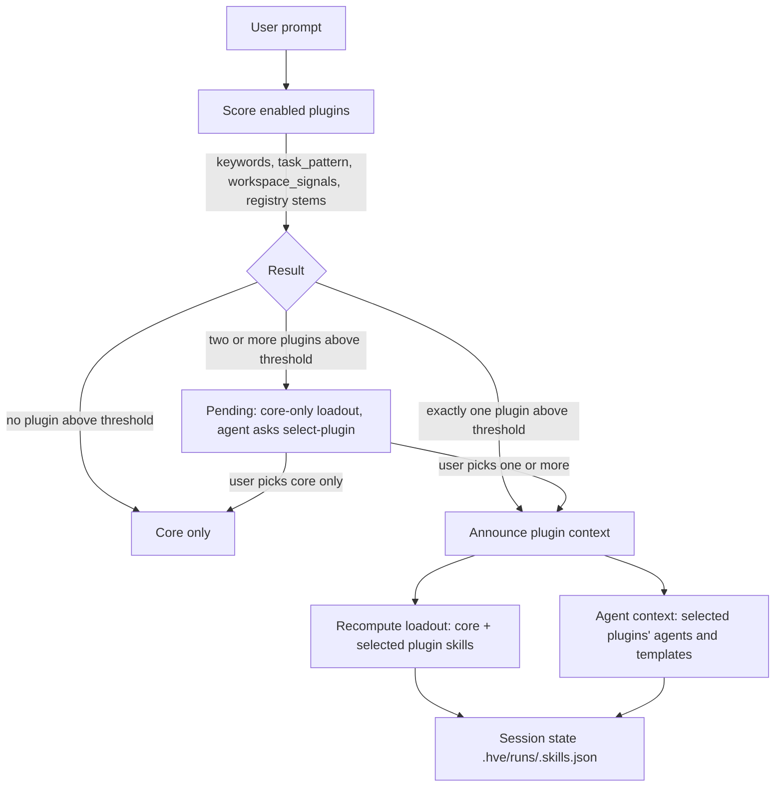

# Plugin Architecture Execution Plan

Status: built (extension 0.9.0, D-048); not verified live (tracker N34).
Decisions recorded at the end; review findings of 2026-10-13 adopted.

Implementation notes (where the build differs from this plan):
- Plugin home is `~/.frontier-hve` (or `HVE_PLUGIN_HOME`), not the extension's globalStorage, so hooks, CLI and other clients share it.
- Rendering runs after the registry commit; `manifest.py` validates every render input first, and activation re-renders.
- `flow.py init --flow core|<plugin>:<flow>`; `HVE creator-flow` picks the flow from the plugin announcement (no `--flow auto`).
- `tools/plugins/manifest.py` is the authority; `schemas/hve-plugin.schema.json` is an editor aid kept in sync by a test.
- Workspace requirements live in `frontier-hve.plugins.json` at the repository root (with a version range), not
  `.hve/plugins.lock.json`: setup offers to gitignore `.hve/`, so a file there often could not be committed.
- The author kit is `plugin.py init` (package in `plugin/` plus a release workflow) and `plugin.py test` (routing cases).
- `plugins/harness-assist` is not converted: it ships Python hook scripts, which the contract forbids, and the extension build
  already bundles it, so it stays a first-party core component rather than an add-on plugin.

## Goal

1. Publish the core harness (Frontier HVE) with a plugin contract, registry and loader.
2. Let users and organizations package skills, agents and templates as a plugin (for example an Oracle offering plugin with
   `oracle-db-architect` and `oracle-engineer` agents, Oracle skills and Oracle deliverable templates).
3. Require plugins to follow one defined structure and register with the core before use.
4. Have the core route each user ask to the right installed plugin's skills, agents or templates, and ask the user when the
   choice is ambiguous.
5. Release and publish each plugin separately from the core: a user installs the core first and adds plugins (for example
   Oracle Offering) later, without rebuilding or reinstalling the core.

## Current State (what the design builds on)

| Concern | Today | Extension point |
|---|---|---|
| Skill library | `skills/registry.json` + `skills/admitted/`, workspace `.hve/skills-registry.json` + `.hve/skill-library/` | `recommend.library_entries()` and `skill_loader.library()` already merge two sources; a plugin source becomes the third |
| Skill selection | `hooks/skill_loader.py` ranks by `categories.json` patterns and stems, loads within budget, asks with header `load-skills` | Same ranking, plugin entries carry a namespace |
| Agents | `extension/agents/*.agent.md`, rendered by `render.js` into one Agent Plugins 1.0 folder registered in `chat.pluginLocations` | Render each enabled plugin into its own plugin folder with the same `{{RUNTIME}}` substitution |
| Templates | `templates/deliverables/catalog.json`, sources `builtin:<name>@1` or workspace path, resolved in `tools/templates/manage.py` | Add `plugin:<plugin>/<template>@<version>` sources |
| Packaging | `extension/build.py` copies runtime, skills, wiki, templates | Add `tools/plugins/` and the plugin schema |
| First-party plugin | `plugins/harness-assist/plugin.json` (Agent Plugins 1.0 manifest only) | Becomes the first plugin that conforms to the new contract (dogfood) |
| Cross-client | `tools/adapters/export.py` | Export enabled plugins' assets alongside core assets |

## Alternatives

| Option | Description | Verdict |
|---|---|---|
| A. Plugin as a VS Code extension | Each org ships a VSIX that depends on `frontier-hve` and calls an exported `registerPlugin()` API | **Selected as a thin wrapper channel only**: the VSIX carries the same `.hveplugin` package and hands it to the core install pipeline, so the package stays adapter-neutral |
| B. Plugin as a standalone package (`.hveplugin` archive, git repo, or path) installed by the core | Core validates the manifest, copies into a plugin store, records it in a registry | **Selected** as the primary mechanism; works for every adapter and for Python hooks |
| C. Org plugin index | A JSON index (URL or repo) listing approved plugins, versions and hashes | **Selected** on top of B for discovery and governance |
| D. Merge plugin assets into core folders | Copy plugin skills into `skills/admitted/` | Rejected: loses provenance, namespacing and clean uninstall |

## Design

### 1. Plugin package structure (contract)

```
oracle-offering/
  hve-plugin.json            # required: HVE manifest (below)
  plugin.json                # optional: Agent Plugins 1.0 manifest; generated by the core if absent
  README.md                  # required: purpose, owner, support contact
  LICENSE / NOTICE           # required
  agents/
    oracle-db-architect.agent.md
    oracle-engineer.agent.md
  skills/
    oracle-schema-design/SKILL.md
    oracle-performance-tuning/SKILL.md
  templates/
    oracle-solution-design-v1.md
    oracle-migration-runbook-v1.md
  registry.json              # skill entries: name, description, task_categories
  categories.json            # optional: extra task categories (merged, namespaced)
```

`hve-plugin.json` (validated by a JSON Schema shipped with the core, `schemas/hve-plugin.schema.json`):

```json
{
  "$schema": "https://.../hve-plugin.schema.json",
  "name": "oracle-offering",
  "displayName": "Oracle Offering",
  "version": "1.2.0",
  "publisher": "contoso-oracle-practice",
  "harness": { "apiVersion": 1, "frontierHve": ">=0.9.0 <2.0.0" },
  "description": "Oracle database architecture, engineering and migration assets.",
  "routing": {
    "domains": ["oracle", "database"],
    "keywords": ["oracle", "pl/sql", "plsql", "exadata", "oci", "rac", "data guard", "goldengate"],
    "task_pattern": "\\b(oracle|pl/?sql|exadata|oci|goldengate)\\b",
    "workspace_signals": ["**/*.pks", "**/*.pkb", "**/tnsnames.ora", "pom.xml:ojdbc"]
  },
  "agents": [
    { "name": "oracle-db-architect", "file": "agents/oracle-db-architect.agent.md",
      "capabilities": ["architecture", "data-model"], "handoffFrom": ["hve-creator", "hve-product-manager"] },
    { "name": "oracle-engineer", "file": "agents/oracle-engineer.agent.md",
      "capabilities": ["implementation", "performance"] }
  ],
  "skills": "registry.json",
  "templates": {
    "assessment": { "file": "templates/oracle-assessment-v1.md", "version": 1, "output": "docs/oracle/ASSESSMENT-{slug}.md" },
    "technicalDesign": { "file": "templates/oracle-solution-design-v1.md", "version": 1 },
    "migrationRunbook": { "file": "templates/oracle-migration-runbook-v1.md", "version": 1,
                          "output": "docs/oracle/RUNBOOK-{slug}.md" }
  },
  "flows": ["flows/oracle-migration.flow.json"],
  "evaluation": "evaluation/oracle-offering.eval.json",
  "tools": ["read/readFile", "search/textSearch", "edit/editFiles", "agent", "vscode/askQuestions"]
}
```

Rules:
- Plugin id is `<publisher>.<name>` (both lowercase kebab-case), for example `contoso-oracle-practice.oracle-offering`.
  The `name` is the short namespace used in prompts and asset names (`oracle-offering:oracle-db-architect`); installing a
  second plugin with the same `name` from another publisher fails. `frontier-hve`, `hve` and `core` are reserved.
- `harness.apiVersion` is the plugin contract version; the core refuses unknown or incompatible versions (fail fast, no
  best-effort load).
- Every file listed must exist; every `agents/`, `skills/`, `templates/`, `flows/`, `evaluation/` entry must be listed
  (no hidden assets). `flows` and `evaluation` are optional; if declared, they must be valid or the install fails (an
  absent flow or contract means the core defaults apply; an invalid one is never silently replaced by them).
- No plugin-authored hooks or executable content in v1: the schema rejects a `hooks` key in `hve-plugin.json` or
  `plugin.json`, a `hooks:` block in any agent frontmatter, a `hooks/` folder, and script files (`*.py`, `*.js`, `*.ps1`,
  `*.sh`, `*.cmd`, `*.exe`). Plugins contain Markdown and JSON only; skills call core tools through `{{RUNTIME}}`.
- Each agent's frontmatter `tools` must be a subset of the manifest `tools`; the manifest list is what the user consents to.
- Plugin skills declare `name`, `description`, `task_categories`. The core normalizes them at install into the ranker's
  record: `status: admitted` (organization-vetted), `skill_tokens` computed from `SKILL.md`, `quality_lift_pp: null`
  (no harness measurement claimed).
- Plugin templates carry the same `hve-template` / `hve-section` markers as the bundled ones. A kind that the core does not
  define (for example `migrationRunbook`) must declare its `output` pattern; it is registered as
  `oracle-offering:migrationRunbook`.

### 2. Core plugin registry and store

Plugins install globally, like the core: one install per user serves every workspace. There is no workspace-scoped store.

| Item | Location | Content |
|---|---|---|
| Plugin store | `<globalStorage>/plugins/<name>/<version>/` | Unpacked, read-only copy |
| Installed registry | `<globalStorage>/plugins.json` | id, version, source, sha256, enabled, consented tools, owner (`user` or wrapper extension id), installed date |
| Org index (optional) | Setting `frontierHve.pluginIndex` (URL or repo path) | Approved plugins, versions, hashes, `revoked` flag |

The store and registry belong to the local VS Code extension host. Remote, container and web hosts are out of scope in v1.

CLI `tools/plugins/plugin.py` (one module) with subcommands: `validate <path>`, `install <path|git-url|index:name@ver>`,
`list`, `enable|disable <name>`, `uninstall <name>`, `resolve "<prompt>"` (debug routing). Extension commands
`Frontier HVE: Install plugin`, `Frontier HVE: Manage plugins` wrap the CLI.

Install pipeline (each step fails loudly and leaves nothing installed on failure):
1. Take the store lock (`<globalStorage>/plugins.lock`; a second window waits or fails with a clear message).
2. Fetch or copy into a staging folder. Reject entries with `..`, absolute paths, links or reparse points, names that
   differ only by case, or a package over the size limit.
3. Validate `hve-plugin.json` against the schema (no hooks, no executable content, agent tools within manifest tools) and
   the `harness.frontierHve` range.
4. Verify sha256 against the org index entry when the source is the index; any other source shows the publisher and hash
   and needs explicit confirmation. A `revoked` entry cannot be installed.
5. Check identity collisions (section 1 rules).
6. Show the manifest `tools` for consent; on upgrade, ask again only if the list grew.
7. Pre-render the plugin's agents into a staging folder, so a render error fails here.
8. Move staging to `plugins/<id>/<version>/` and the rendered folder into place, then replace `plugins.json` atomically
   (write temp file, rename). The registry is the single commit point: a crash before the rename leaves the previous
   state; leftover staging folders are deleted on the next activation.
9. Register the rendered folder in `chat.pluginLocations` and offer a window reload. Activation reconciles any registry
   entry whose rendered folder or `chat.pluginLocations` entry is missing.

Skill content is not re-evaluated or scanned at install: the publishing organization vets and validates it, and the
index hash ties the installed package to the vetted release. The structural checks above are not a content review.

### 3. Integration into the core

| Component | Change |
|---|---|
| `tools/skills/recommend.py` | `library_entries()` adds the normalized entries of the session's selected plugins only, with `path` into the plugin store and a `plugin` field |
| `hooks/skill_loader.py` | Also does plugin routing (section 4), so selection and loadout share one session state and one hook order. `library()` includes all installed plugin skill folders, so the deny rule covers unselected plugin skills; `install()` copies to `.hve/skills/<plugin>__<skill>/` |
| `skills/categories.json` | Plugin `categories.json` merged at runtime under `<plugin>:<category>` |
| `tools/templates/manage.py` | `KINDS` becomes the core kinds plus the selected plugins' declared kinds. `resolve()` accepts `plugin:<name>/<kind>@<version>`. The workspace policy `frontier-hve.templates.json` may map a core kind to a plugin template; plugin-only kinds use the manifest `output`. Provenance records plugin id, version and template hash |
| `extension/render.js` | Renders each enabled plugin into `<globalStorage>/rendered/<id>/` (Agent Plugins 1.0 folder), substituting `{{RUNTIME}}`, and adds core hooks to each plugin agent: `template_guard.py` (as in `hve-single`) and `skill_loader.py` on `UserPromptSubmit`, `PreToolUse` and `PostToolUse` with `HARNESS_PLUGIN=<name>`, which limits the agent to core skills and its own plugin's skills. This holds whether the agent is invoked directly or as a sub-agent, without relying on the parent's session. Flow stage agents also get `flow_guard.py` on `Stop` (section 8). Registers enabled folders in `chat.pluginLocations` and removes disabled ones |
| `extension/extension.js` | Commands `Install plugin` / `Manage plugins`, exported API `installPlugin` / `uninstallPlugin`, and an activation reconcile (section 7) |
| `extension/build.py` | Ships `tools/plugins/plugin.py` and the schema |
| Core agents (`hve-creator`, `hve-product-manager`, `hve-creator-flow` stages) | Instruction block: when the router context names a plugin agent for the task, delegate the matching sub-task to it with the subagent tool; otherwise proceed with core agents |
| `tools/adapters/export.py` | Exports enabled plugins' agents, skills and templates for Claude Code, Cursor and Codex, and removes exported plugin files that are no longer enabled. VS Code is the fully supported client in v1; each client's limits (for example Cursor cannot deliver the routing notice or the `select-plugin` prompt) are added to the existing `GAPS` list |
| Docs | New wiki page `docs/wiki/Plugins.md` (author guide + install guide); `Home.md` link |

### 4. Routing: choosing the right plugin for an ask

Routing lives in `hooks/skill_loader.py` (no second hook), on `UserPromptSubmit`:



Scoring (deterministic, same style as `recommend.relevance`):
- `task_pattern` match: strong signal.
- Keyword and stem overlap weighted by rarity across installed plugins.
- Workspace signals (file globs, dependency markers) add to the score, computed once per session and cached.

Decision rules:
- Exactly one plugin above threshold: use it; announce once via `additionalContext`
  ("Plugin `oracle-offering` applies: agents `oracle-db-architect`, `oracle-engineer`; templates `technicalDesign`.").
- Two or more plugins above threshold, regardless of score gap (for example `oracle-offering` and `postgres-offering`
  both match "migrate Oracle to PostgreSQL"): the agent always asks. Session state is `pending`: the loadout holds core
  skills only and the deny rule blocks every plugin skill; the announcement withholds plugin agents and the template
  manager refuses plugin templates. On the first `PreToolUse` the agent is told to ask with the
  ask-questions tool, header `select-plugin`, multi-select, options = candidate plugins + `Core only`. The `PostToolUse`
  handler records the answer, recomputes and installs the loadout, and the next `PreToolUse` announces it (same pattern
  as `load-skills`). If the question is cancelled, the session stays core only. A new prompt in the same chat re-routes:
  if its candidate plugins are the same as before, the earlier answer is kept; if a new plugin matches, the agent asks
  again. No choice is remembered across chats.
- Several selected plugins: the announcement lists each plugin's agents with their manifest `capabilities`; the agent
  assigns each sub-task to the matching plugin agent (for example Oracle extraction to `oracle-engineer`, target design to
  the PostgreSQL architect) and says which agent handles what before starting.
- Explicit mention in the prompt (`@oracle-offering`, `use oracle plugin`, or a namespaced asset name) overrides scoring.
  A mention of a plugin that is not installed or is disabled stops with a message naming the plugin and the install
  command; it does not fall back to core silently.
- Delegated plugin agents run with their own `HARNESS_PLUGIN` limit (section 3); the orchestrator passes the selected
  plugins and task in the delegation prompt.
- Conflicting templates (core `technicalDesign` vs plugin `technicalDesign`): the workspace `catalog.json` decides; if
  the chosen plugin offers a template for a kind the catalog maps to `builtin:`, the agent asks once whether to switch and
  records the answer in the catalog only on the user's choice.

Budgets: plugin skills share the existing per-task loadout budget; plugin skills are never discoverable globally (same
token rationale as D-029/D-031); only the chosen plugin's skills are ranked in.

### 5. Governance and safety

- No fallback: invalid manifest, missing file, hooks or scripts present, incompatible version or hash mismatch stop the
  install with a clear message; a plugin that later fails validation (store tampered) is disabled with an error, not
  loaded partially.
- Trust model: plugins are trusted content from the publishing organization, not sandboxed. The manifest `tools` limits
  which host tools plugin agents are given; it does not stop a granted terminal tool from reaching the network.
- Supply chain: the org index is the trusted reference; its sha256 proves the package matches the vetted release. Activation
  disables an installed plugin whose index entry is `revoked`. Private feeds use the user's existing git or Azure
  credentials; the core stores no secrets. Publisher signatures are a later phase.
- Path safety: all plugin paths resolved inside the store (reuse `safe_path` approach from `manage.py`), plus the archive
  checks in section 2.
- Provenance: generated deliverables and run records include `plugin@version`; metrics attribute skill lift per plugin.
- Skill quality: owned by the publishing organization, which vets and validates skills before release; the core trusts
  plugin skills as admitted and does not gate them on harness micro-evals.

### 6. Versioning and compatibility

- Core publishes `apiVersion` (starting at 1) and a semver range in `hve-plugin.json` is required.
- Breaking contract changes bump `apiVersion`; the core supports N and N-1 for one minor release with a deprecation notice.
- One version of a plugin is installed and enabled at a time, globally.

### 7. Independent release, publish and install lifecycle

Principle: the core never bundles, references or knows plugins at build time. Plugins depend on the published plugin
contract (`apiVersion`, schema, `{{RUNTIME}}` tool paths), never on core source files. Core and each plugin have their own
repository, version, changelog, CI and release cadence.

```mermaid
sequenceDiagram
  participant Org as Plugin team (own repo + CI)
  participant Ch as Channel (org index / GitHub Release / Azure Artifacts / VS Code Marketplace)
  participant User
  participant Core as Frontier HVE core (already installed)
  Org->>Org: hve-plugin validate + pack -> oracle-offering-1.2.0.hveplugin + sha256
  Org->>Ch: publish package, add index entry (name, version, url, sha256, frontierHve range)
  User->>Core: Frontier HVE: Install plugin (browse index / URL / file) or install wrapper VSIX
  Core->>Ch: download package
  Core->>Core: install pipeline (section 2), store in globalStorage, render agents
  Core-->>User: plugin enabled, no core reinstall; reload window to see the new agents
```

Published core surface (what plugin authors build against, released with the core):
- `hve-plugin.schema.json` at a stable versioned URL, and the `apiVersion` table in `docs/wiki/Plugins.md`.
- Plugin author kit: `hve-plugin init` (scaffold the layout in section 1), `validate`, `pack`, `test` (runs the plugin's
  router cases against an installed core). Shipped as the same `tools/plugins/plugin.py` CLI inside the
  core runtime, plus a template repository with a CI workflow (validate, pack, attach to release).
- Stable runtime tool paths under `{{RUNTIME}}` that plugin agents may call; anything not listed is private and may change.

Release artifact:
- `<name>-<version>.hveplugin`: a zip with `hve-plugin.json` at the root, all assets, and `SHA256SUMS`. Deterministic
  packing so the published hash is reproducible from the tagged source.
- Publishing channels (all supported in v1, user decision 2026-10-13), each carrying the same artifact: org index (JSON in
  a repo or Azure Artifacts universal package feed), GitHub Release asset, local file or git URL, or a wrapper VSIX on the
  VS Code Marketplace / private gallery. The channel only changes how the package is fetched; validation, hash check,
  consent and registration are identical.

Wrapper VSIX (for teams that want Marketplace distribution and auto-update):
- `package.json` has `extensionDependencies: ["muralim-ai2.frontier-hve"]`, so VS Code installs the core first if missing.
- On activation it calls the core's exported API `frontierHve.installPlugin(packagePath)` with its bundled `.hveplugin`;
  the core runs the full install pipeline. The wrapper contains no logic of its own.
- The registry records the wrapper as the plugin's owner. VS Code gives no reliable in-process uninstall event, so on
  every activation the core reconciles: a plugin whose owning wrapper is no longer installed is uninstalled, and a
  wrapper whose bundled version differs from the registry is installed through the pipeline. Uninstalling a wrapper
  therefore takes effect on the next window start.

Core-first, plugin-later behavior:
- The plugin store and registry live in the core's `globalStorage`, not in the extension install folder, so they survive
  core updates and serve every workspace.
- Installing, enabling, disabling or upgrading a plugin re-renders only that plugin's agent folder and updates
  `chat.pluginLocations`. Skills and templates apply from the next prompt (the loader reads the registry per prompt);
  agents appear after the window reload the core offers, as for the core agents today. Restart-free agent discovery is
  not promised until verified live.
- Core upgrade: on activation the core re-renders every enabled plugin (the `{{RUNTIME}}` path changes per core version)
  and rechecks each plugin's `frontierHve` range; an incompatible plugin is disabled with a message naming the required
  version, never loaded partially.
- Plugin upgrade: `plugin.py upgrade <name>` or the index's newer version. The registry switch is atomic; chats started
  before it keep reading their session's copied skills, and new chats use the new version. The previous version folder
  is deleted on the next activation. Explicit rollback with `install <name>@<old>`.
- Core without plugins behaves exactly as today (router returns core only, no question asked).
- Required plugins: a repo can commit `frontier-hve.plugins.json` (name, semver range, source). Opening that workspace prompts
  to install a missing plugin globally. If the installed global version is outside the range, the core shows the conflict
  and asks before changing it; it never replaces a global version silently, since other workspaces share it.

### 8. Optional plugin SDLC flow and plugin rubrics

A plugin may ship its own SDLC flow (for example an Oracle migration lifecycle) and its own evaluation rubrics. Both are
optional. If the selected plugin provides them, the core uses them; otherwise the core uses its default flow
(`tools/loop/flow.py`) and `evaluation/frontier.eval.json`. Flows run only under `HVE creator-flow`, the existing graph
workflow entry point. Other agents (`HVE creator`, `HVE product-manager`) use the selected plugin's agents, skills,
templates and rubrics but keep their own process.

**Approach: one engine, flows as data.** Today the stages, edges and evidence are hard-coded in `flow.py`, and plugins
may not ship scripts. So `flow.py` keeps its state machine (edges, back-edge caps, escalation, `resume`) but reads the
graph from a JSON definition. The current graph moves unchanged into `evaluation/flows/core.flow.json`, so the default
behavior and the benchmark profile stay identical. A plugin flow is another definition validated by the same loader.

Flow definition (`flows/oracle-migration.flow.json` in the plugin, listed in `hve-plugin.json` under `"flows"`):

```json
{
  "id": "oracle-migration",
  "description": "Assess, design, migrate, validate and cut over an Oracle workload.",
  "start": "assess",
  "stages": {
    "assess":   { "agent": "oracle-offering:oracle-db-architect", "instructions": "flows/assess.md" },
    "design":   { "agent": "oracle-offering:oracle-db-architect", "instructions": "flows/design.md" },
    "build":    { "agent": "core:builder" },
    "validate": { "agent": "oracle-offering:oracle-engineer", "instructions": "flows/validate.md" }
  },
  "edges": {
    "assessed":        { "from": "assess",   "to": "design",   "evidence": [{ "type": "template-valid", "kind": "oracle-offering:assessment" }] },
    "design-approved": { "from": "design",   "to": "build",    "evidence": [{ "type": "template-valid", "kind": "technicalDesign" },
                                                                         { "type": "json-fields", "file": "design.json", "lists": ["acceptance"], "checks": ["prototype_check", "lint_check"] }] },
    "build-complete":  { "from": "build",    "to": "validate", "evidence": [{ "type": "feature-checks" }, { "type": "structure" }] },
    "rework-required": { "from": "validate", "to": "build",    "back": true, "cap": 2 },
    "cutover-ready":   { "from": "validate", "to": "done",     "evidence": [{ "type": "feature-checks" }, { "type": "check", "file": "design.json", "key": "lint_check" },
                                                                         { "type": "artifacts", "paths": [".harness/evidence/**/*.log"] }] }
  },
  "evaluation": "evaluation/oracle-migration.eval.json"
}
```

Evidence is a closed list of core types, each a generalization of an existing `flow.py` check:

| Type | Holds when | Today's equivalent |
|---|---|---|
| `json-fields` | the project file exists, the named lists are non-empty, the named command keys are non-trivial | `design()` |
| `check` | the command stored under `key` in a project file exits 0 | `prototype_check`, `lint_check` |
| `feature-checks` | the feature loop is initialized and every locked check passes now | `feature_checks_fail()` |
| `structure` | no file over the size limit and no no-fallback findings | `structure_problems()` |
| `no-code-growth` | source lines did not grow since a named edge | sweeper rule |
| `linked-list` | every entry of a list file links to a feature | `roadmap-aligned` |
| `template-valid` | the deliverable of that kind validates through `manage.py` | (new; uses the plugin template kinds) |
| `artifacts` | at least one file matches each glob | evaluation `artifacts` hook |

Commands always come from project files that the agent writes and the user can see (as `design.json` works today),
never from the plugin, so a flow stays Markdown and JSON only. When a `json-fields` edge passes, `flow.py` records the
hash of each named command; a later `check` on a changed command fails with a message, so a check cannot be weakened
after approval. `artifacts` evidence counts only files written after the flow started.

Flow validation (install time and `flow.py init`, fail fast): `start` exists; every stage is reachable and can reach
`done`; `done` has no outgoing edges; every edge names known stages; the edges without `back` form no cycle, so only
capped back-edges can loop; every forward edge has at least one evidence entry; every back-edge has a `cap` from 1 to 3;
every stage agent is `core:builder` or an agent of the same plugin; instruction files exist; evidence types are from the
list above; the `evaluation` file, if given, is a valid plugin contract.

**Selecting the flow.** `HVE creator-flow` stays the entry point. At start it runs
`flow.py init . --profile product --flow auto`:
- No selected plugin has a flow: the core flow, exactly as today.
- One selected plugin has exactly one flow: that flow, announced to the user ("Using `oracle-offering:oracle-migration`;
  say 'core flow' to use the default instead").
- More than one candidate flow (several plugins, or one plugin with several flows): the agent asks with header
  `select-flow`, options = the candidate flows + `Core flow` (same always-ask rule as plugins).
- `--profile benchmark` always uses the core flow, so research runs stay comparable.

`init` snapshots the definition into `.harness/flow-definition.json` with plugin id, version and hash, and the engine
reads the graph only from the snapshot. Instructions, agents, templates and the contract still come from the installed
plugin, so if the installed version differs from the snapshot, `status` and `transition` stop with a message to finish
on the old version (reinstall it) or restart the flow with `flow.py init --restart`. No silent mid-flow upgrade.

**Running a plugin flow.** `flow.py status` also returns the current stage's agent and instructions path. The
orchestrator delegates to that agent with the instructions; `core:builder` keeps the existing feature-loop behavior
run by the orchestrator. `HVE creator-flow` lists its allowed sub-agents in frontmatter, so `render.js` appends the
stage agents of enabled plugin flows to that list when it renders.

When a plugin flow reaches `done`, the orchestrator runs the output reflection (the same steps as `HVE creator`) with
the resolved contract, and reports the flow complete only on `pass` or `human-review`; on `revise` it fixes the markers
and re-evaluates within the revision limit. The core flow is unchanged.

**Plugin rubrics.** A plugin may ship evaluation contracts in the existing `frontier.eval.json` format: one at plugin
level (`"evaluation"` in `hve-plugin.json`, used for any output when the plugin is selected) and one per flow.

Contract resolution for `reflection.py prepare --contract`: the running flow's contract, else the selected plugin's
contract, else `frontier.eval.json`. If several selected plugins each have a contract and no flow decides, the agent
asks (header `select-rubrics`). The resolved path, plugin id and version go into the evaluation snapshot, which
`prepare` already takes.

A plugin contract is validated by `contract.py` plus these plugin rules:
- No `command` validation hooks (no executable content); `feature-checks` and `artifacts` only.
- Plugin rubric and hook ids must not reuse core ids. Plugin rubrics may reference core hooks (for example
  `locked-feature-checks`), which keep their core definition.
- A required top-level `coreShare` between 0.2 and 0.5: the share of the final score that the selected core rubrics
  carry. (`contract.py` ignores unknown keys today; the plugin validator reads it.)
- `decision.minimumScore` and `decision.councilPasses` are at least the core contract's values: a plugin can add
  stricter or domain-specific rubrics but cannot lower the bar. Council roles and `maxRevisionPasses` always come from
  the core contract.

**Combining plugin and core rubrics.** The plugin's rubrics always apply. The agent also selects which core rubrics
apply to this output, so the score covers the domain (for example data integrity, rollback readiness, performance
parity) and the general quality bar.

Before `prepare`, the agent writes `.hve/evaluations/input/<run>-rubric-selection.json`:

```json
{
  "include": ["evidence-verification", "safety-maintainability", "constraint-adherence"],
  "exclude": {
    "task-completion": "covered-by:migration-completeness",
    "usability-accessibility": "not-applicable-output-kind"
  },
  "reasons": {
    "task-completion": "migration-completeness scores every requested object and workflow moved end to end."
  }
}
```

`prepare --rubric-selection <file>` checks the selection before any scoring, so the agent cannot drop a rubric after
seeing how it scores. Revision passes reuse the pass-0 selection; a new selection needs a new evaluation. Checks:
- Every core rubric is listed exactly once, in `include` or `exclude`.
- `evidence-verification` and `safety-maintainability` are always included: they keep the score tied to deterministic
  checks and to safe, explicit failure handling.
- `not-applicable-output-kind` is rejected when one of the rubric's validation hooks covers the run's `--output-kind`
  (for example `usability-accessibility` uses `visual-evidence`, which covers `ui` only). This is a sanity check, not
  proof of applicability.
- `covered-by:<id>` must name a rubric in the plugin contract; the agent states the overlap in one sentence in the
  selection file (`"reasons"` map). Whether the overlap is real is the agent's judgment, reviewed by the council.

`prepare` then builds one combined contract and snapshots it: plugin rubrics scaled to `1 - coreShare`, included core
rubrics scaled to `coreShare` in proportion to their core weights, each rubric keeping its own blocking and warning
thresholds, validation hooks = plugin hooks plus the core hooks used by included or referenced rubrics, decision
thresholds as above. The final summary lists the excluded core rubrics with their reasons. With no plugin contract,
nothing changes: the core contract runs alone and no selection file is needed.

## Milestones

1. Contract: `hve-plugin.schema.json`, `docs/wiki/Plugins.md` author guide, `plugin.py validate`; convert
   `plugins/harness-assist` to the contract.
2. Registry and store: `install`, `list`, `enable`, `disable`, `uninstall`, global store, lock, atomic registry,
   archive, collision, no-hooks and no-script checks.
3. Asset integration: normalized skills in `recommend.py` / `skill_loader.py`, extensible template kinds in `manage.py`,
   agents with core guards in `render.js`, extension commands; `build.py` packaging.
4. Routing in `skill_loader.py`: pending state, multi-select `select-plugin`, loadout recompute, core-agent delegation
   instructions.
5. Sample plugin: `examples/plugins/oracle-offering` (2 agents, 2 skills, 2 templates) used as the end-to-end fixture.
6. Adapters and governance: `export.py` support, org index with hashes, provenance in deliverables and metrics.
7. Separate release: `init`/`pack`/`test` author kit, deterministic `.hveplugin` artifact, plugin template repo with CI,
   core API `installPlugin`/`uninstallPlugin` for wrapper VSIXs, re-render and compatibility check on core upgrade,
   `frontier-hve.plugins.json`. Proven by publishing the sample Oracle plugin from its own repo and installing it into an
   already-installed core.
8. Plugin flows and rubrics: move the core graph to `core.flow.json` with no behavior change (existing flow tests stay
   green), generic evidence types, flow validation, `--flow auto` selection and `select-flow`, definition snapshot,
   stage agent in `status`, render of `creator-flow` sub-agents, contract resolution, plugin contract rules, rubric
   selection file and combined contract in `prepare`, agent instructions for selecting core rubrics. The
   sample Oracle plugin gains a migration flow and its own contract.

## Verification (authored during implementation; execution offered separately)

- `tests/test_plugins.py`: schema accept/reject cases, version range, id collision, reserved names, path traversal,
  links, case collisions, hash mismatch, revoked entry, hooks in manifest or agent frontmatter rejected, scripts rejected,
  agent tools outside manifest rejected, interrupted install leaves the previous registry, render failure installs
  nothing, declared but invalid flow or contract rejected.
- Routing cases: one match, no match, two or more matches always trigger `select-plugin` with plugin skills denied until
  answered, multi-select, cancel stays core only, explicit mention, mention of a missing plugin fails, new chat asks again,
  same chat keeps the answer for the same candidates and asks again when a new plugin matches, a plugin agent cannot
  read another plugin's skills.
- Skill loader: plugin skill normalized (tokens computed, lift null) and loaded within budget regardless of
  `HARNESS_SKILLS_MIN_STATUS`; plugin skill outside loadout denied.
- Templates: `plugin:` source resolves for a core kind and for a plugin-declared kind with its output; provenance
  recorded; unknown plugin, kind or version fails.
- Extension: render of enabled plugins, removal on disable, `chat.pluginLocations` updated.
- Adapter export includes plugin assets.
- Lifecycle: install into a core with no plugins; core upgrade keeps plugins and re-renders them; incompatible core range
  disables the plugin with a message; plugin upgrade and rollback; `pack` is reproducible (same hash twice); wrapper VSIX
  install goes through the core pipeline and its removal is reconciled on the next activation; lock file prompts for
  missing plugins and reports a version-range conflict without changing the global install.
- Flows: the core flow from `core.flow.json` passes the existing `tests/test_flow_plugin.py` and loop tests unchanged;
  invalid plugin flows are rejected (unreachable stage, no path to `done`, forward edge without evidence, back-edge
  without cap or cap over 3, forward-edge cycle, outgoing edge from `done`, foreign agent, unknown evidence type,
  missing instructions); `--flow auto` picks core with
  no plugin flow, the plugin flow with one, and asks with several; benchmark profile always uses core; a plugin version
  change mid-flow stops `status` and `transition`; a changed check command fails; stale artifacts do not count; a
  plugin flow at `done` runs the reflection; every evidence type blocks a transition when it does not hold.
- Rubrics: contract resolution order; plugin contract with a `command` hook, a lower `minimumScore` or
  `councilPasses`, a missing or out-of-range `coreShare`, or a reused core rubric or hook id is rejected. Selection: missing or
  duplicate core rubric, excluded `evidence-verification` or `safety-maintainability`, `not-applicable-output-kind` for
  a rubric whose hooks cover the output kind, and `covered-by` naming an unknown plugin rubric are rejected. Combined
  weights sum to 1 with the declared split; hooks and decision thresholds are merged as specified; no plugin contract
  means the core contract runs unchanged; a revision pass reuses the pass-0 selection; the snapshot records the plugin
  id, version and the selection.

## Out of Scope (initial release)

- Public marketplace UI, paid licensing, plugin-to-plugin dependencies, plugin hooks and executable helpers, sandboxing,
  remote/container/web extension hosts, workspace-scoped installs, harness-side evaluation of plugin skills,
  side-by-side plugin versions, publisher signatures, automatic
  plugin updates without user action (wrapper VSIX updates follow the user's VS Code auto-update setting and still run
  the core install pipeline).

## Decisions (user, 2026-10-13)

1. Release channels: any of org index, GitHub Release, local file or git URL, or wrapper VSIX.
2. Plugin hooks: not allowed in v1, and no executable content (scripts) either; plugins contain Markdown and JSON only.
3. Install scope: global, like the core.
4. Skill quality: plugin skills are vetted and validated by the publishing organization; the core trusts them as admitted.
5. Multiple matching plugins: the agent always asks.
6. Plugin SDLC flow: when exactly one selected plugin offers one flow, it starts automatically and is announced; with
   several candidates the agent asks; otherwise the core flow runs.
7. Rubrics: plugin rubrics always apply, combined with the core rubrics the agent selects as applicable, under the
   deterministic selection rules in section 8.
