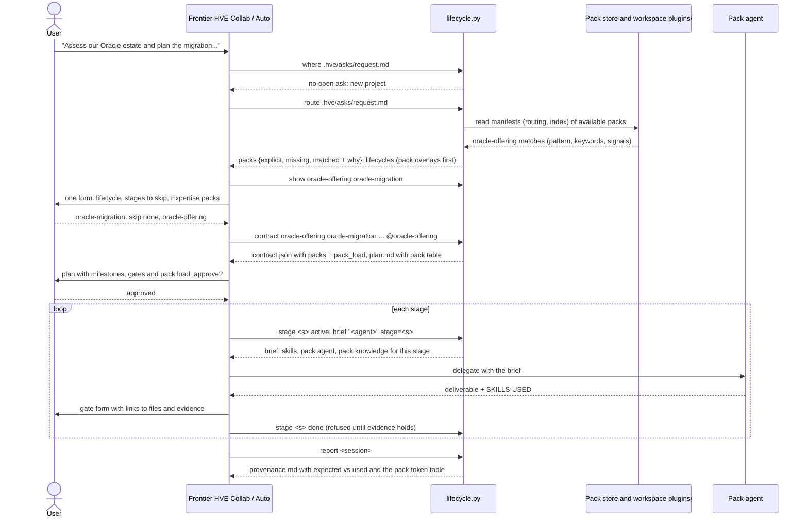
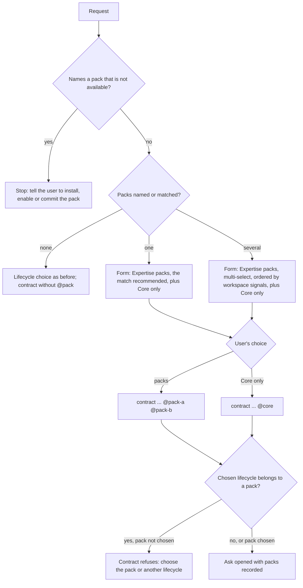
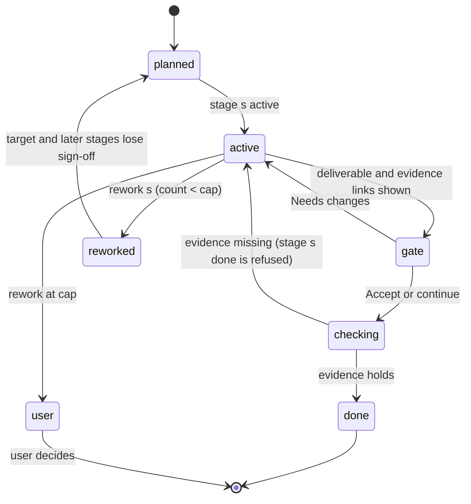
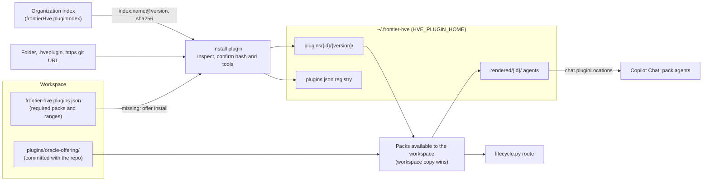

# Expertise packs (plugins)

An **expertise pack** puts one practice's tribal knowledge into a form the Frontier agents can use: how the practice works (its process), what it knows (process maps, runbooks, common fixes), who does the work (personas), how it writes things down (templates), and how its work is judged (rubrics). When a request is about that practice, **Frontier HVE Auto** and **Frontier HVE Collab** find the pack, offer it, and run the ask with it.

The idea in one line: **the agent reads the pack's manifest, never the whole folder.** The manifest holds the routing rules and an index of everything in the pack, with a one-line "use when" for each knowledge document. Only what a stage needs is opened, and the plan and provenance show how many tokens each pack added.

Packs are the product name for the plugin architecture planned on branch `plugin-architecture/pj-1013` and built in PR #8; decision D-060 records how it was brought into the lifecycle contract.

- [Why packs](#why-packs)
- [What is in a pack](#what-is-in-a-pack)
- [How it works: the flows](#how-it-works-the-flows)
- [Worked example: an Oracle migration with Frontier HVE Collab](#worked-example-an-oracle-migration-with-frontier-hve-collab)
- [More examples](#more-examples)
- [Token load: what a pack costs in context](#token-load-what-a-pack-costs-in-context)
- [Writing a pack](#writing-a-pack)
- [Sharing and installing packs](#sharing-and-installing-packs)
- [Trust and governance](#trust-and-governance)
- [Auto and Collab compared](#auto-and-collab-compared)
- [Troubleshooting](#troubleshooting)
- [Reference](#reference)
- [Not yet](#not-yet)

## Why packs

Every practice (Oracle, SAP, Salesforce, data platforms, a regulated delivery method) has knowledge that lives in people's heads and scattered documents: the order things are done in, the fixes that always work, the checklist before a cutover, the template the client expects. Without packs an agent either knows none of it or is handed a large folder and reads all of it, which is slow, expensive and unfocused.

| Without a pack | With a pack |
|---|---|
| The agent picks a generic lifecycle (`sdlc`, `agile-scrum`) | The practice's own overlay is offered first, with the reason it matched |
| Generic personas do every stage | The practice's personas (`oracle-offering:oracle-db-architect`) run their stages |
| Knowledge is pasted into the chat or missed | Each stage's brief lists the practice documents for that stage, opened only when needed |
| Generic templates | The practice's templates (`oracle-offering:assessment`) with validated sections |
| "Done" means the user said so | A stage can require evidence (a valid document, a passing check, logs) before it is done |
| Nobody knows what the extra context cost | Plan and provenance show each pack's tokens, absolute and as a share |

## What is in a pack

A pack is one folder of Markdown and JSON only: no scripts, no hooks, nothing that runs.

```text
oracle-offering/
├── hve-plugin.json                     manifest: identity, routing, index of every asset
├── README.md                           owner and support (required)
├── LICENSE                             (required)
├── registry.json                       the pack's skills with descriptions and task categories
├── categories.json                     optional: the pack's own task categories
├── agents/
│   ├── oracle-db-architect.agent.md    persona for assess and design
│   └── oracle-engineer.agent.md        persona for validate
├── skills/
│   ├── oracle-schema-design/SKILL.md
│   └── oracle-performance-tuning/SKILL.md
├── templates/
│   ├── oracle-assessment-v1.md         new kind: oracle-offering:assessment
│   ├── oracle-solution-design-v1.md    replaces the core technicalDesign when configured
│   └── oracle-migration-runbook-v1.md  new kind: oracle-offering:migrationRunbook
├── lifecycles/
│   └── oracle-migration.json           the practice's process (overlay)
├── knowledge/
│   ├── migration-process-map.md        process map
│   └── common-fixes.md                 common solutions
├── evaluation/
│   └── oracle-offering.eval.json       the practice's rubrics
└── tests/
    └── routing.json                    prompts that should and should not route here
```

### The parts

| Part | What it is | How agents use it |
|---|---|---|
| **Routing** | `domains`, `keywords`, a `task_pattern` regex, and `workspace_signals` (globs such as `**/tnsnames.ora`, or `file:text` such as `pom.xml:ojdbc`) | Matched against the request; workspace signals order several matching packs |
| **Lifecycle (overlay)** | A process in the same format as the built-in lifecycles: stages with goal, agent, skills, plugin skills, templates, exit gate and when to skip, plus optional `evidence` and `rework` | Offered in the lifecycle choice as `<pack>:<name>` |
| **Agents** | Personas with their own instructions and allowed tools (within the tools the manifest declares) | Rendered as `<pack>:<agent>` with the core guard hooks; a stage delegates to them |
| **Skills** | Vetted instructions (`SKILL.md`) | Ranked with the library as `<pack>:<skill>`, copied into `.hve/skills/<pack>__<skill>/` |
| **Templates** | Deliverables with `hve-template` and `hve-section` markers | New kinds as `<pack>:<kind>`; a core kind can be replaced |
| **Knowledge** | Process maps, runbooks, common solutions, references | Indexed in the manifest with `use_when` and `stages`; listed in the stage brief; opened on demand |
| **Rubrics** | An evaluation contract in the core format with a `coreShare` | Combined with the core rubrics in the output evaluation |

### The manifest

```json
{
  "$schema": "https://github.com/muralim-ai2/Frontier-HVE/schemas/hve-plugin.schema.json",
  "name": "oracle-offering",
  "displayName": "Oracle Offering",
  "version": "1.0.0",
  "publisher": "contoso-oracle-practice",
  "harness": {"apiVersion": 1, "frontierHve": ">=0.8.0 <1.0.0"},
  "description": "Oracle database architecture, engineering and migration assets for Frontier HVE.",
  "routing": {
    "domains": ["oracle", "database"],
    "keywords": ["oracle", "pl/sql", "plsql", "exadata", "goldengate", "data guard"],
    "task_pattern": "\\b(oracle|pl/?sql|exadata|goldengate)\\b",
    "workspace_signals": ["**/*.pks", "**/*.pkb", "**/tnsnames.ora", "pom.xml:ojdbc"]
  },
  "agents": [
    {"name": "oracle-db-architect", "file": "agents/oracle-db-architect.agent.md", "capabilities": ["assessment", "architecture", "data-model"]},
    {"name": "oracle-engineer", "file": "agents/oracle-engineer.agent.md", "capabilities": ["implementation", "performance", "validation"]}
  ],
  "skills": "registry.json",
  "templates": {
    "assessment": {"file": "templates/oracle-assessment-v1.md", "version": 1, "output": "docs/oracle/ASSESSMENT-{slug}.md"},
    "technicalDesign": {"file": "templates/oracle-solution-design-v1.md", "version": 1},
    "migrationRunbook": {"file": "templates/oracle-migration-runbook-v1.md", "version": 1, "output": "docs/oracle/RUNBOOK-{slug}.md"}
  },
  "lifecycles": ["lifecycles/oracle-migration.json"],
  "knowledge": [
    {"id": "migration-process-map", "file": "knowledge/migration-process-map.md", "title": "Oracle migration process map",
     "kind": "process-map", "use_when": "Planning or sequencing an Oracle migration: phases, owners and hand-offs.", "stages": ["assess", "design"]},
    {"id": "common-fixes", "file": "knowledge/common-fixes.md", "title": "Common Oracle migration fixes",
     "kind": "solution", "use_when": "A migrated object fails to compile, a sequence drifts, or row counts differ after a load.",
     "stages": ["build", "validate"]}
  ],
  "evaluation": "evaluation/oracle-offering.eval.json",
  "tools": ["read/readFile", "search/fileSearch", "search/textSearch", "search/listDirectory", "edit/editFiles", "edit/createFile",
            "execute/runInTerminal", "execute/getTerminalOutput"]
}
```

`lifecycles`, `knowledge` and `evaluation` are optional; everything else is required. `knowledge[].stages` is a list of stage names, or `[]` for every stage.

### The overlay (lifecycle)

```json
{
  "name": "oracle-migration",
  "title": "Oracle migration (Oracle Offering pack)",
  "summary": "Assess the Oracle estate, design the target, build the migration as verified features, validate data and rollback, then hand over.",
  "fits": ["oracle", "plsql", "migration", "migrate", "exadata", "goldengate", "database", "schema", "estate", "cutover"],
  "stages": [
    {"name": "assess", "goal": "Inventory the estate and write the assessment.", "agent": "oracle-offering:oracle-db-architect",
     "skills": ["oracle-offering:oracle-schema-design"], "plugin_skills": [], "templates": ["oracle-offering:assessment"],
     "exit": "The user accepts the assessment and its recommendation.", "skip_when": "An accepted assessment already exists.",
     "evidence": [{"type": "template-valid", "kind": "oracle-offering:assessment"}]},
    {"name": "design", "...": "technicalDesign, evidence template-valid technicalDesign"},
    {"name": "build", "agent": "HVE engineer", "...": "evidence feature-checks"},
    {"name": "validate", "goal": "Prove data integrity and a rehearsed rollback; write the runbook.", "agent": "oracle-offering:oracle-engineer",
     "skills": ["oracle-offering:oracle-performance-tuning"], "plugin_skills": [], "templates": ["oracle-offering:migrationRunbook"],
     "exit": "The user accepts the validation evidence and the runbook.", "skip_when": "Never: cutover needs this evidence.",
     "evidence": [{"type": "template-valid", "kind": "oracle-offering:migrationRunbook"},
                  {"type": "artifacts", "paths": ["{ask}/loop/evidence/**/*.log"]}],
     "rework": {"to": "build", "cap": 2}},
    {"name": "release", "agent": "self", "plugin_skills": ["explain-walkthrough"], "...": "hand over"}
  ]
}
```

Names inside a pack overlay follow one rule: **pack assets carry the `<pack>:` prefix, core assets do not.** `oracle-offering:oracle-db-architect` is the pack's persona, `HVE engineer` is the core one; `oracle-offering:oracle-schema-design` is a pack skill, `build-approach` a library skill; `oracle-offering:assessment` is a pack template, `technicalDesign` the core kind.

### Stage evidence and rework

| Evidence type | Fields | Holds when |
|---|---|---|
| `template-valid` | `kind` | A document of that template kind exists and passes the template manager's validation (provenance, sections, no placeholders) |
| `json-fields` | `file`, `lists`, `checks` | The JSON file has each listed field as a non-empty list and each check field as a real command |
| `check` | `file`, `key` | The command in that JSON field exits 0 |
| `feature-checks` | none | Every feature of the project's feature loop passes |
| `artifacts` | `paths` | Each glob matches at least one file |

Paths are workspace-relative; `{ask}` stands for the ask folder (`.hve/asks/<id>`). `rework` is `{"to": "<an earlier stage>", "cap": 1-3}`: the number of times the stage may send the work back before the user decides.

## How it works: the flows

### Flow 1: from request to a running ask



### Flow 2: the routing decision



What counts as a match:

| Signal | Example | Effect |
|---|---|---|
| Named with `@` | `@oracle-offering migrate the HR schema` | Named (explicit) |
| Named asset | `use oracle-offering:oracle-engineer for the load` | Named (explicit) |
| Named in words | `use the oracle pack`, `with the oracle-offering plugin` | Named (explicit); a hyphenated name that is not available is reported missing |
| Task pattern | `\b(oracle|pl/?sql|exadata|goldengate)\b` matches "PL/SQL" | Matched, with the matched text as the reason |
| Keyword | `goldengate`, `data guard` | Matched, one reason per keyword |
| Workspace signal | `**/tnsnames.ora` exists, `pom.xml` contains `ojdbc` | Orders matched packs; shown as "workspace has ..." |

### Flow 3: a stage with evidence and rework



### Flow 4: where a pack comes from



On every start the extension cleans up the store, disables packs revoked in the index or changed on disk, offers missing required packs, renders the agents of every available pack and offers a reload when they changed.

## Worked example: an Oracle migration with Frontier HVE Collab

The workspace has the sample committed as `plugins/oracle-offering/`. The request:

> Assess our Oracle estate and plan the migration to the new PL/SQL schema

### 1. Route

Collab writes the request to `.hve/asks/request.md` and runs `lifecycle.py route .hve/asks/request.md`:

```json
{
  "packs": {
    "explicit": [],
    "missing": [],
    "matched": [
      {"name": "oracle-offering", "version": "1.0.0", "source": "workspace", "signals": 0,
       "why": ["task pattern matched 'Oracle'", "keyword 'oracle'", "keyword 'pl/sql'"]}
    ]
  },
  "lifecycles": [
    {"name": "oracle-offering:oracle-migration", "pack": "oracle-offering", "matched": ["estate", "migrat", "oracle", "schema"]},
    {"name": "consulting-delivery", "pack": null, "matched": ["assess"]},
    {"name": "agile-scrum", "pack": null, "matched": []}
  ]
}
```

### 2. The form

Collab shows the top two overlays and a stage table from `lifecycle.py show oracle-offering:oracle-migration`, then asks once:

| Question | Options |
|---|---|
| Overlay | **Oracle migration (Oracle Offering pack)**: matched estate, migrate, oracle, schema · Consulting delivery |
| Steps to skip | assess, design, build, validate, release (multi-select) |
| Expertise packs | **oracle-offering**: task pattern matched 'Oracle', keywords 'oracle', 'pl/sql' · Core only |
| Reason | free text |

### 3. The contract

If the agent forgets the pack choice, the contract stops it:

```text
ValueError: packs ['oracle-offering'] match this ask: ask the user and pass @<pack> for each chosen pack, or @core for none
```

With the user's choice recorded:

```text
lifecycle.py contract oracle-offering:oracle-migration ora "Frontier HVE Collab" .hve/asks/request.md @oracle-offering
```

`contract.json` now holds the pack record:

```json
"packs": [{
  "name": "oracle-offering", "id": "contoso-oracle-practice.oracle-offering", "version": "1.0.0", "source": "workspace",
  "sha256": "1ed00d75...9e31ad",
  "routed": ["task pattern matched 'Oracle'", "keyword 'oracle'", "keyword 'pl/sql'"],
  "lifecycle": "oracle-offering:oracle-migration",
  "agents": ["oracle-db-architect", "oracle-engineer"],
  "templates": ["oracle-offering:assessment", "oracle-offering:migrationRunbook"],
  "knowledge": [
    {"id": "migration-process-map", "title": "Oracle migration process map", "kind": "process-map", "stages": ["assess", "design"], "tokens": 293},
    {"id": "common-fixes", "title": "Common Oracle migration fixes", "kind": "solution", "stages": ["build", "validate"], "tokens": 218}
  ],
  "evaluation": "<pack folder>/evaluation/oracle-offering.eval.json",
  "tokens": {"index": 566, "knowledge_index": 110, "lifecycle": 633, "knowledge": 511, "agents": 546, "templates": 357}
}]
```

The pack skills are in the ask's skills as `oracle-offering:oracle-schema-design` and `oracle-offering:oracle-performance-tuning`, copied to `.hve/skills/oracle-offering__oracle-schema-design/` and `.hve/skills/oracle-offering__oracle-performance-tuning/`, and the decisions log `packs: oracle-offering (offered ['oracle-offering'])`.

### 4. The plan

The generated skills block of `plan.md` gains:

```markdown
Expertise packs (1,664 tokens always loaded, 15.0% of this ask's 11,092-token contracted context, 1.3% of a 128,000-token window):

| Pack | Always loaded | Share of ask context | Share of window | On demand |
|---|---|---|---|---|
| oracle-offering 1.0.0 | 1,664 | 15.0% | 1.3% | 1,414 |

- oracle-offering: routed by task pattern matched 'Oracle', keyword 'oracle', keyword 'pl/sql'; lifecycle oracle-offering:oracle-migration;
  agents oracle-db-architect, oracle-engineer; templates oracle-offering:assessment, oracle-offering:migrationRunbook;
  knowledge migration-process-map, common-fixes
```

### 5. A stage brief

For the assess stage Collab runs `lifecycle.py brief "oracle-offering:oracle-db-architect" stage=assess` and passes it verbatim:

```text
Frontier HVE brief: ask 20261023-0302-ora, stage assess
- Ask folder: .hve/asks/20261023-0302-ora/ (prototypes and drafts go there, never in the workspace root)
- Read and follow before you start: .hve/skills/oracle-offering__oracle-schema-design/SKILL.md, .hve/skills/oracle-offering__oracle-performance-tuning/SKILL.md, ...
- Plugin skills you may use: feature-checklist, explain-walkthrough
- Pack agent for this stage: oracle-offering:oracle-db-architect (its instructions: <pack folder>/agents/oracle-db-architect.agent.md)
- Pack knowledge (open a document only when its use-when applies): Oracle migration process map (process-map, 293 tokens) at
  <pack folder>/knowledge/migration-process-map.md: use when Planning or sequencing an Oracle migration: phases, owners and hand-offs.
- MCP servers available: ...
- Rules: ...
- End your reply with one line: SKILLS-USED: <the skills you actually followed, comma-separated, or none>
```

Only the process map is listed: the common-fixes document belongs to build and validate.

### 6. Evidence at the gate

After the user accepts the assessment at the persona hand-off, `lifecycle.py stage assess done "assessed"` checks the stage evidence. Without a valid assessment document:

```text
ValueError: stage assess cannot be done: its evidence is missing: no valid oracle-offering:assessment document at docs/oracle/ASSESSMENT-{slug}.md
```

The architect writes it through the template manager (`manage.py init oracle-offering:assessment --slug estate --session <s>`), fills every section, and the stage is done.

### 7. Rework

At validate the row counts differ. Collab runs `lifecycle.py rework validate "row counts differ"`:

```json
{"current": "build", "rework": 1, "cap": 2}
```

Build and validate lose their sign-off and the sprint goes back to build. A third rework is refused and the user decides:

```text
RuntimeError: stage validate reached its rework cap of 2: ask the user how to proceed
```

### 8. Provenance

`lifecycle.py report <session>` writes `provenance.md` with an **Expertise packs** section, and the same facts go to `.hve/runs/<session>.provenance.json` (`contract.packs`, `contract.pack_load`):

| Pack | Always loaded (index, knowledge index, lifecycle, skills) | On demand (knowledge, agents, templates) | Share of ask context | Share of window | Share of first / peak prompt |
|---|---|---|---|---|---|
| oracle-offering 1.0.0 | 1,664 (566, 110, 633, 355) | 1,414 (511, 546, 357) | 15.0% | 1.3% | not measured |

With research telemetry on for the ask, the last column shows the pack's always-loaded tokens as a share of the first and the peak measured prompt.

## More examples

### Two packs match

> Migrate our Oracle PL/SQL estate to Postgres

Both `oracle-offering` and `postgres-offering` match. The form asks **Expertise packs** as a multi-select (ordered by workspace signals: a workspace with `tnsnames.ora` lists Oracle first), plus **Core only**. Choosing both gives `contract ... @oracle-offering @postgres-offering`; each pack gets its own record and token row, and the skill loader allows the skills of both.

### A named pack is not available

> Use the mysql-offering plugin to migrate the billing schema

`route` returns `"missing": ["mysql-offering"]`. The agent stops and tells the user to install or enable the pack (**Frontier HVE: Install plugin**), or commit it as `plugins/mysql-offering/`. It does not continue with the core harness instead.

### The user prefers core only

The form offers the Oracle pack and the user picks **Core only** with `sdlc`. The contract records `@core`; no pack skills load, the pack's skills stay closed to the agent, and `plan.md` says "Expertise packs: none (core only)". Choosing the pack's own overlay with **Core only** is refused: a pack overlay needs its pack.

### A pack adds knowledge to a core lifecycle

A pack does not have to ship an overlay. A `sap-offering` pack with only skills and knowledge, chosen with the built-in `sdlc`, adds its skills to the ranking and lists its knowledge in each brief whose stage name matches the document's `stages` (or every stage when `stages` is `[]`).

### Naming a pack directly

> @oracle-offering write the cutover runbook for the HR schema

The pack is named (explicit) even if no keyword matches; its overlay leads the lifecycle list.

## Token load: what a pack costs in context

Every asset is measured when the manifest is validated (characters ÷ 4). The ask's load is computed from what the ask actually uses:

| Measure | Formula | Oracle example |
|---|---|---|
| Index | tokens of `hve-plugin.json` (what the agent reads instead of the folder) | 566 |
| Knowledge index | tokens of the knowledge entries (id, title, kind, use_when, stages) | 110 |
| Lifecycle | tokens of the pack overlay, when the ask runs it | 633 |
| Skills | tokens of the pack skills in the ask's skills (after any skill choice) | 355 |
| **Always loaded** | index + knowledge index + lifecycle + skills | **1,664** |
| Knowledge | tokens of the knowledge documents of the ask's stages | 511 |
| Agents | tokens of the pack agents the ask's stages use | 546 |
| Templates | tokens of the pack templates the ask's stages use | 357 |
| **On demand** | knowledge + agents + templates (read only when a stage opens them) | **1,414** |
| Ask context | all selected skills + every pack's always-loaded tokens other than skills | 11,092 |
| **Share of ask context** | always loaded ÷ ask context | **15.0%** |
| **Share of window** | always loaded ÷ the first reference window in `skills/categories.json` | **1.3%** of 128,000 |
| Share of first / peak prompt | always loaded ÷ the measured prompt tokens (provenance only, when measured) | not measured |

The numbers are recomputed whenever the plan's generated blocks refresh, so they follow a skill choice (`lifecycle.py skills suggested|all|<a,b>`). Pack skills count toward the ask's skill guideline (10 skills, 32,000 tokens) like any other skill.

## Writing a pack

### 1. Start from the author kit

```text
python <tools>/plugins/plugin.py init my-pack-repo --name sap-offering --publisher contoso-sap --display-name "SAP Offering"
```

It creates `plugin/` (a valid minimal pack: one agent, one skill, one template, one knowledge document, routing tests) and `.github/workflows/release-plugin.yml`. `<tools>` is the harness tools folder: `tools/` in this repository, `<extension>/runtime/tools` in the installed extension.

### 2. Write down the routing

Pick keywords people actually type, a task pattern for the unambiguous terms, and workspace signals that only this practice's projects have. Add cases to `tests/routing.json`, including prompts that must not route:

```json
{"cases": [
  {"prompt": "Assess our Oracle estate and plan the migration", "routes": true},
  {"prompt": "Tune this PL/SQL package", "routes": true},
  {"prompt": "Use the oracle plugin to review the schema", "routes": true},
  {"prompt": "Fix the button color on the login page", "routes": false}
]}
```

### 3. Capture the process as an overlay

Write the practice's stages in `lifecycles/<name>.json`. Use your personas for the expert stages, `HVE engineer` for build stages (the orchestrator runs them as a verified feature loop), and `self` for reviews the lead agent runs. Add `evidence` where "done" must be provable and `rework` where work typically goes back.

### 4. Capture the knowledge

Put each document in `knowledge/` and index it. The `use_when` line is what the agent reads to decide whether to open the document, so write it as a trigger:

| Weak `use_when` | Strong `use_when` |
|---|---|
| "Oracle information" | "A migrated object fails to compile, a sequence drifts, or row counts differ after a load." |
| "Process" | "Planning or sequencing an Oracle migration: phases, owners and hand-offs." |

Kinds: `process-map` (phases, owners, hand-offs), `runbook` (ordered steps for an operation), `solution` (symptom, cause, fix), `reference` (facts to look up). Keep documents short and focused: a document is opened whole.

### 5. Skills, agents, templates, rubrics

- **Skills:** `skills/<name>/SKILL.md` plus an entry in `registry.json` (`name`, `description`, `task_categories` from the core categories or the pack's `categories.json`). Pack skills are treated as vetted by the publisher.
- **Agents:** frontmatter keys `name`, `description`, `tools`, `agents`, `user-invocable`, `argument-hint` only (no hooks); tools must be within the manifest's `tools`. The core hooks are added when the agent is rendered.
- **Templates:** exactly one `<!-- hve-template: <kind>@<version> -->` marker, `<!-- hve-section: <id> -->` markers and `{{FILL: ...}}` placeholders. A new kind declares an `output` with one `{slug}`; a core kind must not.
- **Rubrics:** the core evaluation format plus `coreShare` (0.2-0.5, the weight left to the core rubrics). No `command` hooks, no core rubric ids, and `minimumScore` and `councilPasses` at least the core values.

### 6. Validate, test, package

```text
python <tools>/plugins/plugin.py validate plugin/
python <tools>/plugins/plugin.py test plugin/
python <tools>/plugins/plugin.py pack plugin/ --out dist
```

`pack` writes a reproducible `<name>-<version>.hveplugin` with `SHA256SUMS`. Pushing a `v*` tag runs the release workflow (repository variables `FRONTIER_HVE_REPO` and `FRONTIER_HVE_REF`).

### Common validation errors

| Error | Fix |
|---|---|
| `plugins contain Markdown and JSON only; not allowed: agents/helper.py` | Remove scripts; packs carry no code |
| `undeclared assets: ['knowledge/extra.md']` | Declare every file under agents, templates, lifecycles, knowledge and evaluation in the manifest |
| `lifecycle oracle-migration: stage assess agent 'other-pack:architect' is not a agent of pack oracle-offering` | A pack overlay names only its own `<pack>:` assets, or core ones without a prefix |
| `... rework needs exactly to (an earlier stage [...]) and cap` | `rework.to` must be a stage before this one |
| `... rework cap must be an integer from 1 to 3` | Lower the cap |
| `knowledge[0] needs exactly a kebab-case id, file, title, kind, use_when and stages` | Add the missing field (`stages: []` for every stage) |
| `tools [...] are not in the manifest tools the user consents to` | Add the tool to the manifest `tools` or remove it from the agent |
| `plugin needs Frontier HVE >=9.0.0; this core is 0.16.0` | Widen `harness.frontierHve` |

## Sharing and installing packs

| Way | How | Good for |
|---|---|---|
| **Workspace** | Commit the pack as `plugins/<pack>/` in the repository | One team, one repository; reviewed in pull requests like code; validated each time it is used; wins over an installed copy |
| **Installed** | **Frontier HVE: Install plugin**: organization index (`name@version`), folder, `.hveplugin` file, or https git URL ending in `.git` | A practice used across many repositories; installed once per machine into `~/.frontier-hve` |
| **Required** | Commit `frontier-hve.plugins.json` | A repository that needs specific packs; the extension offers to install missing ones on start |

```json
{"version": 1, "plugins": [{"name": "oracle-offering", "range": ">=1.0.0 <2.0.0", "source": "index:oracle-offering@1.0.0"}]}
```

The organization index (setting `frontierHve.pluginIndex`, a path or https URL):

```json
{"version": 1, "plugins": [
  {"name": "oracle-offering", "version": "1.0.0", "url": "https://.../oracle-offering-1.0.0.hveplugin", "sha256": "...", "revoked": false}
]}
```

**Frontier HVE: Manage plugins** enables, disables or uninstalls an installed pack. A version installed outside a workspace's required range is reported, never changed, because other workspaces share the install.

## Trust and governance

| Concern | Control |
|---|---|
| Code execution | Packs hold Markdown and JSON only; no scripts, no `hooks/` folder, no hooks in `plugin.json` or agent frontmatter |
| Hidden content | Every asset file must be declared; links, case-only name clashes and packages over 20 MB are refused |
| Tampering | Installs record a content sha256; on start a pack whose store content changed is disabled |
| Unknown sources | Install shows publisher, sha256 and the tools its agents may use; without index verification the user confirms the hash |
| Withdrawn versions | A version marked `revoked` in the organization index is disabled on start and refused on install |
| Tool reach | Pack agents may only use tools the manifest declares, which the user sees at install |
| Wrong pack's knowledge | Skills of packs the ask did not choose are denied by the skill loader |
| Unrecorded choices | The contract refuses an offered pack choice that was not recorded |
| Guards | Pack agents run with the core template guard and skill loader hooks |

## Auto and Collab compared

| | Frontier HVE Auto | Frontier HVE Collab |
|---|---|---|
| Routing | `lifecycle.py route` | `lifecycle.py route` |
| Lifecycle shown | Top two, pack overlays first | Top two; prefers an overlay from a matched pack, a plugin or the workspace |
| Pack question | In the one form, with lifecycle and skips | In the one form, with overlay and skips |
| Pack agents | Delegated stage by stage with the brief | Persona hand-offs with the brief, a review after each |
| Evidence and rework | At each stage gate | At each persona hand-off and sprint review |
| Output evaluation | Always, with pack rubrics | When the user opts in, with pack rubrics |

## Troubleshooting

| Symptom | Cause and fix |
|---|---|
| The pack is never offered | Run `python <tools>/plugins/plugin.py resolve "<request>"` in the workspace: no match means the routing needs keywords or a broader task pattern; add the prompt to `tests/routing.json` |
| A pack is offered for unrelated requests | Narrow the task pattern; drop generic keywords such as "database" |
| Contract says "packs [...] match this ask" | Record the user's pack choice with `@<pack>` or `@core` |
| Contract says the lifecycle "belongs to pack" | Choose that pack, or another lifecycle |
| `stage <s> done` is refused | Fix what it names: write and validate the template document, make the check pass, produce the artifact |
| Rework cap reached | Ask the user how to proceed: raise scope, change direction, or accept with a note |
| Pack agents do not appear in the agent list | Reload the window after installing; check **Manage plugins** shows the pack enabled |
| A workspace pack is ignored | It must have `plugins/<pack>/hve-plugin.json` and validate: run `plugin.py validate plugins/<pack>` |
| Token share looks high | Check `plan.md`: large pack skills or a long overlay; split documents into knowledge (on demand) instead of skills (always loaded) |

## Reference

### Commands

| Command | Does |
|---|---|
| `lifecycle.py route <request-file>` | Packs named, missing and matched with why; lifecycles with matched packs' overlays first |
| `lifecycle.py show <pack>:<lifecycle>` | The overlay's stages, evidence and rework |
| `lifecycle.py contract <lifecycle> <slug> <agent> <request-file> [stage=why ...] [+skill ...] [@pack ... \| @core]` | Opens the ask with packs and their token load |
| `lifecycle.py brief "<agent>" stage=<s>` | The stage brief with pack agent and pack knowledge |
| `lifecycle.py stage <s> done "<note>"` | Marks a stage done after its evidence holds |
| `lifecycle.py rework <s> "<why>"` | Steps back to the stage's rework target within its cap |
| `lifecycle.py report <session>` | `provenance.md` with the Expertise packs table |
| `plugin.py validate\|test\|pack <folder>` | Author checks and packaging |
| `plugin.py inspect\|install\|enable\|disable\|uninstall\|list\|reconcile` | Store management (the editor commands call these) |
| `plugin.py resolve "<prompt>"`, `plugin.py packs <workspace>`, `plugin.py requirements <workspace>` | Routing check, available packs, required packs |
| `manage.py init <pack>:<kind> --slug <s> --session <id>` | A pack template document |
| `reflection.py prepare ... --plugin-contract <pack rubric> --rubric-selection <file>` | Output evaluation with pack rubrics |

### Files

| File | Holds |
|---|---|
| `<pack>/hve-plugin.json` | The manifest; schema `schemas/hve-plugin.schema.json`, authority `tools/plugins/manifest.py` |
| `plugins/<pack>/` | A workspace pack |
| `~/.frontier-hve/plugins.json` | Installed packs registry |
| `~/.frontier-hve/plugins/<id>/<version>/` | Installed pack content |
| `~/.frontier-hve/rendered/<id>/` | Rendered pack agents (registered in `chat.pluginLocations`) |
| `frontier-hve.plugins.json` | Packs a repository requires |
| `.hve/asks/<id>/contract.json` | `packs`, `pack_load`, the pack decision |
| `.hve/asks/<id>/plan.md` | The Expertise packs table in the generated skills block |
| `.hve/asks/<id>/provenance.md`, `.hve/runs/<session>.provenance.json` | Packs and their measured load |
| `.hve/skills/<pack>__<skill>/` | Pack skills loaded for the ask |

### Code

| Module | Role |
|---|---|
| `tools/plugins/manifest.py` | Validates a pack and measures its assets |
| `tools/plugins/route.py` | Named, missing and matched packs with reasons |
| `tools/plugins/store.py` | Installed and workspace packs available to a workspace |
| `tools/plugins/plugin.py`, `author.py` | Install lifecycle, packaging, author kit |
| `tools/loop/lifecycle_catalog.py` | Lifecycle catalog including pack overlays, `route` |
| `tools/loop/ask_packs.py` | Pack choice check, contract record, token load, brief, plan and provenance lines |
| `tools/loop/stage_evidence.py` | Stage evidence checks and rework |
| `tools/evaluation/compose.py` | Pack rubrics combined with core rubrics |
| `extension/packs.js`, `extension/render.js` | Install and Manage commands, start-up reconcile, pack agent rendering |

## Not yet

- Pack agents are not exported to Claude Code, Cursor or Codex; there the brief names the agent's instruction file to follow.
- The creator agents (Frontier Lite, creator-flow, creator-github) do not route packs per prompt; creator-flow's graph format is not a pack format.
- No publisher signatures beyond the index hash, no packs that depend on other packs, no sandbox for pack agents beyond their declared tools.
- Live use is not yet verified (tracker N43).
