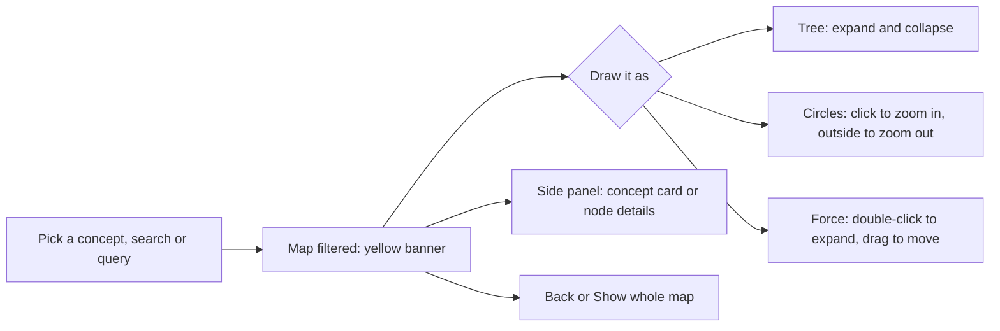

# Solution map

The solution map lets people and agents understand a codebase without reading all of it. It turns a repository into **concepts** (named areas such as Agents, Skills or Telemetry) and **views** (architecture layers), then into modules, files and functions, with typed connections that each name their evidence. You can read it three ways:

- **Explorer:** one offline HTML page with Tree, Circles and Force views.
- **Chat:** `/solution-map <topic>` or "help me understand <topic>" in Copilot, Claude Code or Codex.
- **Command line:** `explain`, `impact`, `search`, `overview` and `status`.

It works on any repository. Nothing in `tools/map/` is specific to this repo; repo-specific names and explanations live in an optional config file.

## Create or refresh the map

**In chat** (Frontier HVE extension 0.17.0 or later):

```
/solution-map create
```

The agent builds the map in `.hve/map/`, reports its size and counts, and opens the explorer. Say `/solution-map publish` to also write the release snapshot to `docs/architecture/` for committing.

**From a terminal**, at the repository root:

```powershell
python tools\map\solution_map.py build              # create or refresh .hve\map\ (map.json, overview.md, explorer.html)
python tools\map\solution_map.py open               # open the explorer
python tools\map\solution_map.py build --snapshot   # publish docs\architecture\solution-map.{json,md,html}
```

For another repository, add `--root <folder>`. With the installed extension, the script is at `<extension folder>\runtime\tools\map\solution_map.py`:

```powershell
$ext = Get-ChildItem "$HOME/.vscode/extensions/muralim-ai2.frontier-hve-*" | Sort-Object LastWriteTime | Select-Object -Last 1
python "$($ext.FullName)/runtime/tools/map/solution_map.py" build --root .
```

The script lives in `tools\map\`; `.hve\map\` holds only the output. Running `python solution_map.py` from inside `.hve\map\` fails with file not found.

## Understand a part of the code

**In chat:** ask "help me understand the telemetry implementation" or type `/solution-map telemetry`. The agent follows the `solution-map` skill:

1. If you did not type `/solution-map`, it first asks whether to use the map.
2. It refreshes the map when files changed since it was built.
3. It answers in this order:

   **Concept › Modules › Files › Functions › Connections › Dependencies › Start at**

   It also names the tests, docs and decisions behind the concept.
4. It offers to open the explorer filtered to the concept, or to show what a change would touch (`impact`).
5. When no concept matches, it lists the closest files and offers to add a concept.

E2E Delivery, BYOW and HVE creator follow the skill whenever you ask how code works.

**From a terminal:**

```powershell
python tools\map\solution_map.py explain "how do plugins work"   # Markdown answer; --json for data
python tools\map\solution_map.py open "concept=packs"             # explorer filtered to a concept
python tools\map\solution_map.py impact --seeds file:tools/loop/lifecycle.py,file:tools/loop/ask_plan.py
python tools\map\solution_map.py status                           # map commit; files added, removed, changed since
```

## The explorer



- **Group by** Concepts (concept › module › file › function) or Architecture (system › view › module › file › function).
- **Draw as:**
  - **Tree:** collapsible; nodes slide when you expand or collapse.
  - **Circles:** zoomable circle packing; size follows file length.
  - **Force:** opens at two levels; double-click to expand; node size grows with connections; colour shows the concept or view.
- **Filter:**
  - **Concept dropdown:** pick a concept to show only its part of the map.
  - **Fuzzy search:** press `/`; matches name, file and purpose.
  - **Cypher query:** for example `MATCH (f:telemetry)-[:imports]->(g) RETURN f, g`. Labels are a level, kind, view, language or concept id.

  A yellow banner shows what you are filtered to, with **Back** and **Show whole map**; Esc also goes back.
- **Concept card:** explanation, start file, modules with files and functions, connections to other concepts, external dependencies, tests, docs, decisions and the questions it answers.
- **Links:** `#concept=telemetry`, `#q=otel`, `#node=file:hooks/metrics.py` or `#cypher=...` at the end of the page address opens it filtered.

The page loads nothing from the network. If your system is set to reduce motion, the floating and animations are switched off.

## What goes into the map

| Layer | Taken from | Without a config |
|---|---|---|
| Concepts | `concepts` in the config: name, keywords, member paths, start file, explanation, questions | One per view, marked derived |
| Views and modules | `views` and `modules` path rules in the config, with names, purposes and roles | Top-level folder = view, folder = module |
| Files | Docstrings, header comments, front matter, README and headings; `purposes` in the config for files without one | Same |
| Functions | Python `ast`; JS/TS, C#, Java and Go declarations with their doc comments | Same |
| Edges | `imports`, `invokes` (names a file it runs), `guarded-by` (agent hooks), `delegates-to`, `tested-by`, `documented-in`, `decided-in` (decision logs and ADRs), `uses` and `writes` (data stores), each with its evidence | Same, without stores |
| Dependencies | Third-party imports (standard library and local modules left out) | Same |

The build also classes the app as small, medium or large: medium from 50 code files or 5,000 code lines, large from 300 files or 50,000 lines.

## Add or improve a concept

Edit `docs/architecture/solution-map.config.json` and rebuild:

```json
{"id": "billing", "name": "Billing", "keywords": ["invoice", "charge"],
 "members": ["^src/billing/", "^src/tax\\.py$"], "start": "src/billing/service.py",
 "explain": "Three to five sentences on what it does, how the parts fit and where data goes.",
 "questions": ["How is tax added?"]}
```

The build stops with a clear error when a concept matches no file or its start file is not a member. Or ask in chat: when no concept fits a question, the agent drafts one from the closest files and adds it with your yes. This repository's 16 concepts are first drafts written from the code; correct them as you find gaps.

## Files

| File | Role |
|---|---|
| `tools/map/extract.py` | Code facts from any repository |
| `tools/map/map_build.py` | Size class, placement, edges, concepts, overview, explorer page |
| `tools/map/solution_map.py` | CLI: `build`, `explain`, `impact`, `search`, `overview`, `status`, `open` |
| `tools/map/explorer/` | Page, styles and scripts, inlined into one file at build |
| `plugins/harness-assist/skills/solution-map/SKILL.md` | The chat entry point |
| `docs/architecture/solution-map.config.json` | This repository's views, modules, stores, concepts, conventions and flows |
| `docs/design/TDS-solution-map.md` | Design, decisions and findings |
| `tests/test_map.py` | Tests |

## Not built yet

These are planned in the TDS:

- The size flag in the ask contract (M1).
- The context meter that refreshes the map when a session passes 25% of its context window (M4).
- The with/without-map benchmark (M5).
- Snapshot diffs (M6).
