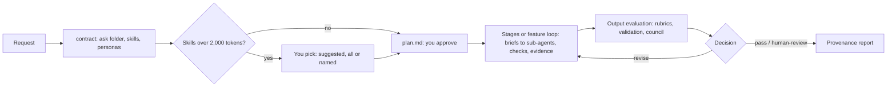

# Ways of working

How a piece of work runs through the HVE agents since extension 0.12.0, what you are asked and when, where the files go, and how to check it worked. Decisions: D-046 to D-051 in `research/decisions/decision_log.md`.

## One ask, one folder

Every piece of work you give a working agent is an **ask**. The agent's first step is `lifecycle.py contract`, which opens a timestamped folder (UTC) and makes it the active ask:

```
.hve/asks/
  active.json                      the open ask
  20261019-1405-colour-palette/
    request.md                     your request, verbatim
    contract.json                  skills, stages, personas, tasks, environment, delegations, decisions
    plan.md                        the plan, with a generated skills-and-tools block
    provenance.md                  expected against used, written at the end
    prototype/                     HVE prototype output
    loop/                          feature_list.json, progress.txt, tracker.json, state.json, attempts/,
                                   evidence/<feature>/, prs/, choices/, checks/, tool_log.jsonl
```

- Your workspace root holds only the product: source code, tests and documents. Loop files, screenshots and logs stay in the ask folder.
- `.hve/` is git-ignored. The loop's commits carry a read-only record instead: `[init]` and `[amend]` list each locked `name: verify`, and `[progress] <feature> passes` names the check that passed.
- Feature checks write screenshots and logs to `$HVE_EVIDENCE/<feature>/`; `loop.py` and the output evaluation set it to the ask's `loop/evidence/`.
- `lifecycle.py close` closes the active ask (user-level and workspace hooks then stay out of the way); `lifecycle.py open <ask-id>` reopens one.

## The flow of an ask



| Agent | Lifecycle | Where you are asked |
|---|---|---|
| `HVE creator` | `direct` | Skill choice, plan and dependencies, escalations, human review of the evaluation |
| `HVE e2e` | You pick (`sdlc`, `consulting-delivery`, `document`, or a plugin or workspace one) and skip stages | Lifecycle and skips, skill choice, plan, a gate after each stage |
| `HVE agile` | An agile overlay (`agile-scrum` or a plugin or workspace one) | Overlay and skips, skill choice, plan, each sprint review |
| `HVE prototype` | None (a clickthrough, no loop or evaluation) | Screen list |
| `HVE product-manager` | `direct`, `prd` required | Skill choice, research questions, backlog target |

## What you are asked, and why

- **Skill choice.** Every library skill relevant to the request is ranked. When the load passes the guideline (10 skills or 2,000 tokens), nothing is dropped silently: the agent shows a suggested set within the guideline (required skills, then the most relevant per token) and asks once. Choose suggested, all, or named skills; `lifecycle.py skills` records the choice and the tokens over the guideline in `plan.md` and `contract.json`. Keeping all costs those tokens on every turn of the ask; the provenance report then shows how much of the prompt was read from cache.
- **Plan.** `plan.md` is the agreement. If you edit it mid-run, the plan check holds `loop.py` and stage changes until the agent tells you what changes and runs `lifecycle.py plan-sync`.
- **Gates and sprint reviews** (`HVE e2e`, `HVE agile`): continue, change direction, or stop.
- **Escalations.** When the loop is stuck (same failure, circular fixes, attempt cap) it stops and asks you one question; only you can resume.
- **Guard waivers.** After 3 trips of the same guard in a session, the agent asks whether to keep it or lay it down for the session. Loop state, hook bypass, pushes and the plan check are never waivable, and guards are strict again during the output evaluation.

## Switching topics

Keep one kind of work per chat and one product per workspace. When a prompt starts different work from the open ask, the harness says so once:

| Situation | Example | Recommendation |
|---|---|---|
| Follow-up | "make the timeline scroll smoothly" in a timeline app ask | None |
| New work of the same kind | A chess quiz app after a War of the Worlds app | New chat |
| A different kind of deliverable | A board presentation on revenue forecasting after a War of the Worlds app | New workspace (open another folder) |

It never blocks. If you stay, the agent opens a new ask in the same workspace and records the recommendation in its contract (`previous_ask`). `lifecycle.py shift "<prompt>"` shows the verdict for a prompt. The check compares subject words, so a follow-up phrased very differently can trigger it; that costs one line.

## Skills, tools and hooks during an ask

- **Skills**: the contract installs the chosen skills to `.hve/skills/`; other library skills are blocked so they cannot leak into context. Sub-agents get them through their brief (`lifecycle.py brief`) and end their reply with `SKILLS-USED: ...`, which the parent records (`lifecycle.py used`).
- **Tools**: working agents have no fixed tool list, so they see your MCP servers. The contract records each harness's MCP servers with an estimated tool-definition load and warns over 6,000 tokens; disable servers the ask does not need.
- **Hooks** (VS Code Local runs them per agent; other harnesses after **Frontier HVE: Install for other harnesses**):

| Hook | Fires | Leaves |
|---|---|---|
| `skill_loader` | prompt submit, before and after tools | `.hve/runs/<session>.skills.json`; topic-switch message |
| `loop_guard` | before and after tools, stop | `<ask>/loop/tool_log.jsonl`; denies in `.hve/runs/<session>.interventions.jsonl` |
| `module_guard` | after edits | split request for files over 500 lines |
| `plan_check` (e2e, agile) | prompt submit, before loop and stage commands | holds runs while `plan.md` is out of sync |
| `compaction` | sub-agent start | ask skills and rules in every sub-agent |
| `template_guard` | session start and stop | deliverables only from configured templates |
| `profile_detector` | session start, prompt submit | `.hve/user_profile.json` (build preference, explanation depth) |
| `metrics` (research arms in `.github/agents/` only) | every event | `.hve/runs/<session>.events.jsonl` and, with research telemetry, `<session>.jsonl` (tokens, cost, cache per model call) |

`HVE prototype` runs only `loop_guard` (safety); creator, e2e and agile run all but `metrics`.

## Check that it worked

From the workspace root (`<repo>` is a clone of this repository, or use the extension's `runtime/` folder):

```
python <repo>/tools/observe/provenance.py <repo>/extension/agents/hve-creator.agent.md latest
```

It reports each component the agent declares as `verified`, `not-exercised` or `failed`, plus the ask contract (gaps, skills recommended but unused, skills used outside the contract) and guard trips. The ask's `provenance.md` (`lifecycle.py report <session>`) adds the recommended-against-used table, the skill load and the prompt cache.

Five pillars, in priority order (README section 6). The product agents record quality and load; per-call tokens, cost and cache come from the `metrics` hook, which only the research arms run (`tools/observe/bench.py`, with research telemetry on):

| Pillar | Product agents (HVE ...) | Research arms (`bench.py`) |
|---|---|---|
| Quality | Feature checks in `<ask>/loop/tracker.json`; the evaluation's decision and score in `.hve/evaluations/<run>/report.json` | Same, plus blind human and AI scores (`compare.py`) |
| Cost | Not measured | `trace.cost_aiu` (Copilot AI units) |
| Token efficiency | Skill load and estimated MCP tool load in `plan.md` and `provenance.md`; sub-agent replies under 2,000 tokens | `trace.prompt_tokens` (first, peak, total), `trace.model_calls` |
| Latency | Wall clock from `contract.json` → `created` to the last commit or the evaluation report | Per-call timestamps; `tools/observe/trajectory.py` |
| Cache efficiency | "not measured" in `provenance.md` | `trace.cache_read_ratio`; the prompt-cache line in `provenance.md` |

## Ten-minute smoke test of the four delivery agents

Use an empty folder with `git init` and run each prompt in a **new Local chat** with the named agent. Answer every question with the first or recommended option. Each prompt keeps the work small on purpose.

| # | Agent | Prompt | About |
|---|---|---|---|
| 1 | `HVE prototype` | `Clickthrough of a leave request flow with three screens: my balance, request form, confirmation. Placeholder data only.` | 1.5 min |
| 2 | `HVE creator` | `Build a colour palette page: pick a base colour, show 5 tints and 5 shades, and a WCAG contrast check of each against white and black. Plain HTML, CSS and JS, no dependencies. Use the feature loop with exactly 3 features whose checks run with node or python only.` | 4 min |
| 3 | `HVE e2e` | `Create a one-page executive memo for the board on the FY27 revenue forecast: base 120m, upside 135m, downside 104m, drivers price and volume. I supply the data, so skip research.` Then, in the same chat: `Build a War of the Worlds timeline app.` | 2.5 min |
| 4 | `HVE agile` | `One sprint for a leave portal. Backlog is ready, skip the backlog step: story 1 "see my leave balance", story 2 "request leave". Sprint 1 takes both stories, UI design only: run sprint-design, skip sprint-build and release, then hold the sprint review and stop.` | 2 min |

What to check after each chat:

| Check | Expect |
|---|---|
| `.hve/asks/` | One timestamped folder per ask with `request.md`, `contract.json`, `plan.md`; the prototype in its `prototype/`; creator's loop files and `evidence/` in its `loop/`. Nothing new in the workspace root except product files |
| Skills | Creator and e2e ask the suggested/all/named question (both prompts pass 2,000 tokens; agile may too); `plan.md` shows the choice. `.hve/runs/<session>.skills.json` lists what loaded and was read |
| Briefs | Agile's call to `HVE prototype` and creator's sub-agents start with "Frontier HVE brief"; `contract.json` → `delegations` and `reported` filled |
| Hooks | `.hve/runs/<session>.skills.json` for creator, e2e and agile (skill loader); creator's `loop/tool_log.jsonl` has pre and post rows (loop guard); `.hve/user_profile.json` exists (profile detector); `.hve/runs/<session>.interventions.jsonl` only if a guard tripped |
| Topic switch | The War of the Worlds prompt in chat 3 gets a "new workspace" recommendation |
| Git | `git log` shows `[init] scaffold` with the locked checks in its body and one `[progress]` commit per feature |
| Provenance | `provenance.py` per agent file is `ok` or names what failed; `provenance.md` in each ask gives skill load, recommended against used and decisions |
| Pillars | Quality from creator's checks and evaluation decision; latency from `contract.json` → `created` to the last commit; tokens as skill and tool load. Cost and cache need the research arms |
