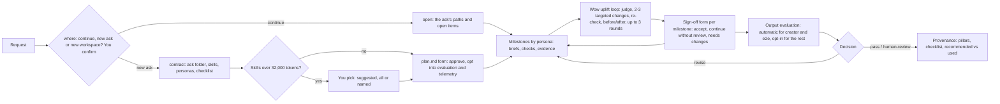
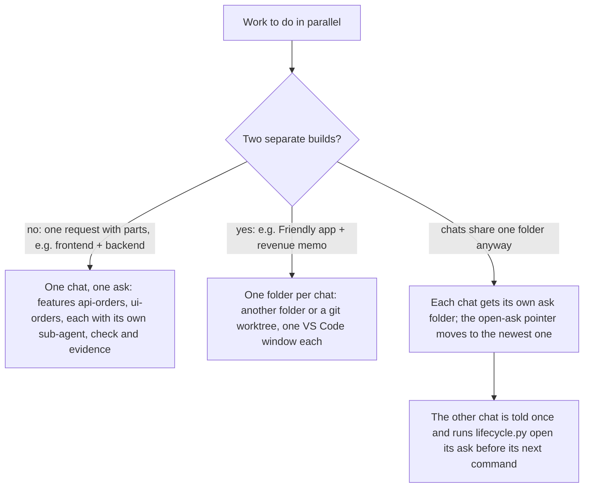

# Ways of working

How a piece of work runs through the HVE agents since extension 0.13.0 (project level since 0.15.0), what you are asked and when, where the files go, and how to check it worked. Decisions: D-046 to D-054 in `research/decisions/decision_log.md`.

## One project per workspace, one folder per ask

A workspace holds one **project**. Every piece of work you give a working agent is an **ask** within it. The agent's first step is `lifecycle.py where`, which says whether your prompt continues the open ask, starts a new ask in the project, or belongs in another workspace; the agent confirms that with you in one form. A new ask runs `lifecycle.py contract`, which opens a timestamped folder (UTC) and makes it the active ask; the first ask also starts the project (`.hve/project/project.json`):

```
.hve/project/                      shared by every ask of the workspace's project
  project.json                     name, goal, kind of deliverable, asks
  feature_list.json                the product's features; each locked feature records the ask that added it
  feature_list.add.json            new features for `loop.py amend`
  progress.txt, tracker.json, state.json
.hve/asks/
  active.json                      the open ask
  20261019-1405-colour-palette/
    request.md                     your request, verbatim
    contract.json                  skills, stages, personas, tasks, environment, delegations, decisions
    plan.md                        this ask's plan, with generated skills-and-tools and sign-off checklist blocks
    provenance.md                  expected against used, written at the end
    prototype/                     Frontier Prototype Creator output
    loop/                          attempts/, evidence/<feature>/ (and evidence/prototype/), prs/, choices/, checks/, tool_log.jsonl
```

- Your workspace root holds only the product: source code, tests and documents. Loop files stay in `.hve/project/`; screenshots and logs stay in the ask folder.
- `.hve/` is git-ignored. The loop's commits carry a read-only record instead: `[init]` and `[amend]` list each locked `name: verify`, and `[progress] <feature> passes` names the check that passed.
- Feature checks write screenshots and logs to `$HVE_EVIDENCE/<feature>/`; `loop.py` and the output evaluation set it to the open ask's `loop/evidence/`.
- The first ask runs `loop.py init`; later asks add features with `feature_list.add.json` and `loop.py amend`. An ask's tasks, sign-offs and report count only the features it added.
- Every prompt gets the open ask's paths (plan, evidence, feature list) as context, and every sub-agent gets the ask folder, so agents never search for `plan.md`.
- `lifecycle.py close` closes the active ask (user-level and workspace hooks then stay out of the way); `lifecycle.py open <ask-id>` reopens one and prints its paths and open items.

## The flow of an ask



| Agent | Lifecycle | Where you are asked |
|---|---|---|
| `HVE creator` | `direct` | Skill choice, plan and dependencies with the telemetry option, escalations, feature sign-off, human review of the evaluation |
| `Frontier E2E Delivery` (`hve-e2e`) | You pick (`sdlc`, `consulting-delivery`, `document`, or a plugin or workspace one) and skip stages | Lifecycle and skips, skill choice, plan with the telemetry option, a sign-off and gate form after each stage |
| `Frontier BYOW` (`hve-agile`, Bring your own way of working) | An agile overlay (`agile-scrum` or a plugin or workspace one) | Overlay and skips, skill choice, plan with evaluation and telemetry options, a hand-off review after each persona, each sprint review |
| `Frontier Prototype Creator` (`hve-prototype`) | `direct` when you run it; none as BYOW's designer (it works in BYOW's ask) | Screens, skill choice and options in one form; sign-off of the self-checked clickthrough with its screenshots |
| `HVE product-manager` | `direct`, `prd` required (none as E2E or BYOW's persona) | Skill choice, options, research questions, backlog target, PRD sign-off |

Every agent that opens asks also asks first whether to continue the open ask, start a new one in the project, or move to a new workspace.

## What you are asked, and why

- **Skill choice.** Every library skill relevant to your ask is shortlisted, with no cap, and ranked by relevance. If the shortlist passes the guideline (10 skills or 32,000 tokens), the agent scores each skill 0-10 for your ask across its stages and `lifecycle.py skills score` re-ranks the shortlist and suggests the top 10; the agent shows you the shortlist size and the suggested skills with their scores and reasons and asks once: suggested, all, or named (scores and the choice are recorded in `plan.md`). Loaded skills cost their tokens on every turn of the ask; the provenance report then shows how much of the prompt was read from cache.
- **Guards (D-056).** The loop guard is in awareness mode for now (`hooks/guard_mode.json`, `"loop_guard": "advise"`): edits to the loop files or loop state while features fail, and stopping with failing features, are not blocked but shown in the chat as **Advisory alert (experimental): surfaces LLM behaviour that helps to know**, with what was changed. Escalations, hook bypasses, resume and pushes stay blocked. The error guard pauses the agent after 3 failed commands in a row (the feature loop's own checks do not count) and shows **Error guard - paused for your attention** with the commands and their output; tools stay held until your next prompt.
- **Telemetry file.** On every start, and when research telemetry is turned on, the extension trims `.hve/runs/copilot-otel.jsonl` to the last 3 days, at most 200 MB (`tools/observe/otel_trim.py`), adds it to `.gitignore`, and says what it did.
- **Plan.** `plan.md` is the agreement. If you edit it mid-run, the plan check holds `loop.py` and stage changes until the agent tells you what changes and runs `lifecycle.py plan-sync`.
- **Sign-off checklist.** `plan.md` ends with a generated checklist you can tick in the file or through the agent's forms:

  ```
  **Options**
  - [ ] opt:evaluation — Output evaluation when the work is done ...
  - [ ] opt:telemetry — Research telemetry for this ask ...
  **Milestones**
  - [ ] stage:requirements — Agree the problem ... (persona HVE product-manager; skills prd; templates prd; gate: ...; status planned)
  - stage:test — skipped: checks cover it
  **Tasks** (evidence from each check)
  - [ ] task:feed — build, HVE engineer; check passes; evidence `.hve/asks/<id>/loop/evidence/feed/`
  ```

  After each milestone the agent asks: *Reviewed - accept*, *Continue without reviewing* (fine, recorded as such) or *Needs changes*; it skips the question when you already ticked the item. `lifecycle.py tick <item> <value> "<note>"` records an answer, `lifecycle.py checklist` takes in your ticks from `plan.md` and lists what is still open. Ticking inside the generated block does not trigger the plan check. A stage set back to planned (a new sprint, a change of direction) loses its sign-off.
- **Persona hand-offs** (`Frontier BYOW`): after each persona's step (product manager, designer, engineer) the agent pauses, says what was delivered and where, names the next persona, and asks the sign-off question before switching. A step whose persona is the engineer (sprint build, and the E2E build stage) is a feature loop the orchestrator runs itself, one engineer per feature; an engineer handed a whole stage refuses.
- **Prototype self-check** (`Frontier Prototype Creator`): before you see it, `tools/prototype/check.py lint` checks the clickthrough (no network calls, external scripts or code from strings, every screen present, no dead `#` links) and `check.py shots` saves a headless Edge or Chrome screenshot of each screen to the ask's `loop/evidence/prototype/`.
- **Wow uplift** (every deliverable you see, all three Frontier agents): before the sign-off, `HVE uplift-judge` (a top model, read-only) looks at the files and screenshots and names two or three small, targeted improvements (a heading hierarchy, a theme, a wordmark, a better grid; for decks fewer words, a flow instead of bullets, alignment). The agent applies them, re-runs every check, captures the same views again and asks the judge for the next round, up to 3 rounds or until it says `done`. Images per round go to the ask's `loop/evidence/uplift/round-<n>/`, the summary to `uplift.md`.
- **Presentations**: any deck follows the `presentation-deck` skill. One discovery form first (format: editable `.pptx` or web slides; kind of deck: informational, analysis, pitch, decision, status or workshop; audience; theme: NorthStar ink with one accent, brand colours or a template; text level; how visual; speaker notes; length; logo), then an outline of takeaway titles, a `python-pptx` build with `deck_kit.py` (header band, cards, chips, chevron flows, layers, metric tiles, one takeaway bar per slide), `check_deck.py lint` and PowerPoint slide previews. Web slides instead follow `frontend-slides` (MIT, from `zarazhangrui/frontend-slides`): three style previews to pick from, then one animated HTML file at `presentation/<slug>/index.html`. Decks are never deployed to a public host.
- **Output evaluation.** Automatic for `HVE creator` and `Frontier E2E Delivery`. `Frontier BYOW`, `Frontier Prototype Creator`, `HVE product-manager`, `HVE creator-flow` and `HVE creator-github` ask for it as a checkbox in the plan form and run it when ticked (shared `output-evaluation` skill); `HVE single` never asks and runs it only when your request does. Outputs without a feature loop (a prototype, a PRD, a memo) are scored and judged; the locked checks are marked not applicable with the reason.
- **Research telemetry** (opt-in per ask, for every agent that asks questions): tick `opt:telemetry` and run **Frontier HVE: Turn on research telemetry**; it records full chat content, measures chats started afterwards, and a status bar item stays visible until you run **Frontier HVE: Turn off research telemetry** (or click the item). The agent and `provenance.md` remind you to turn it off.
- **Gates and sprint reviews** (`Frontier E2E Delivery`, `Frontier BYOW`): continue, change direction, or stop.
- **Escalations.** When the loop is stuck (same failure, circular fixes, attempt cap) it stops and asks you one question; only you can resume.
- **Guard waivers.** After 3 trips of the same guard in a session, the agent asks whether to keep it or lay it down for the session. Loop state, hook bypass, pushes and the plan check are never waivable, and guards are strict again during the output evaluation.

## Continue, new ask, or new workspace

One workspace holds one project. Before a new contract the agent runs `lifecycle.py where <request file>` and asks you once, with its verdict as the recommended option:

| Verdict | Example (project: a colour palette app) | What happens |
|---|---|---|
| `continue` | "Fix the palette page contrast", or you come back the next day | `lifecycle.py open <ask>`: same plan, same feature list, open items listed |
| `new-ask` | "Build a settings screen" | A new ask folder and plan; its features join the project's list through `loop.py amend` |
| `new-workspace` | "Create a board presentation on revenue forecasting" (a different kind of deliverable), or a new build sharing almost no subject words with the project | Recommends another folder or git worktree in a new window; if you stay, a new ask records the recommendation (`previous_ask`) |
| `new-project` | First ask in an empty workspace | The contract starts `.hve/project/project.json` |

The skill loader also recommends a new workspace once per ask when a prompt starts a different project. `lifecycle.py shift "<prompt>"` shows that verdict. The check compares subject words with the project's goal, asks and features, so a follow-up phrased very differently can trigger it; that costs one line and you decide.

## Parallel chats

Every ask gets its own folder, also when another chat's ask is still open. A folder has one git checkout, though, so pick the pattern by what runs in parallel:



| Pattern | Example | What HVE does |
|---|---|---|
| One ask with parts (recommended) | "Build the orders page and its API" | One contract and checklist; features `api-orders`, `ui-orders` run one after another, each by a fresh sub-agent |
| One folder per parallel chat | `git worktree add ../shop-memo -b memo`, open it in a new window | Each folder has its own `.hve/` (ask, loop, evidence, logs); merge the branches when done. Use different feature names: loop branches are shared across worktrees |
| Two chats in one folder | Prototype in chat 2 while creator plans in chat 1 | Chat 2's `contract` opens its own ask folder and reports `previous_open`; chat 1's skill loader tells it once that the open ask moved, and it runs `lifecycle.py open <its ask>` before going on. Two feature loops at the same time cannot share one checkout |

An ask finishes when its milestones are done (agents end with `lifecycle.py stage deliver done`) and any evaluation you asked for has run. Personas delegated inside an ask (`HVE product-manager`, `Frontier Prototype Creator`) work in the parent's ask and do not open their own.

## Skills, tools and hooks during an ask

- **Skills**: the contract installs the chosen skills to `.hve/skills/`; other library skills are blocked so they cannot leak into context. Sub-agents get them through their brief (`lifecycle.py brief`) and end their reply with `SKILLS-USED: ...`, which the parent records (`lifecycle.py used`).
- **Tools**: working agents have no fixed tool list, so they see your MCP servers. The contract records each harness's MCP servers with an estimated tool-definition load and warns over 6,000 tokens; disable servers the ask does not need.
- **Hooks** (VS Code Local runs them per agent; other harnesses after **Frontier HVE: Install for other harnesses**):

| Hook | Fires | Leaves |
|---|---|---|
| `skill_loader` | prompt submit, before and after tools | `.hve/runs/<session>.skills.json`; the open ask's paths on every prompt; new-workspace message |
| `loop_guard` | before and after tools, stop | `<ask>/loop/tool_log.jsonl`; denies in `.hve/runs/<session>.interventions.jsonl` |
| `module_guard` | after edits | split request for files over 500 lines |
| `plan_check` (E2E, BYOW) | prompt submit, before loop and stage commands | holds runs while `plan.md` is out of sync |
| `compaction` | sub-agent start | ask folder, evidence path, ask skills and rules in every sub-agent |
| `agent_ledger` | sub-agent start and stop | `.hve/runs/<session>.agents.jsonl`: parent agent, sub-agent name and id, ask, time, and the model when the client sends it (Cursor, Codex) |
| `template_guard` | session start and stop | deliverables only from configured templates |
| `profile_detector` | session start, prompt submit | `.hve/user_profile.json` (build preference, explanation depth) |
| `metrics` (research arms in `.github/agents/` only) | every event | `.hve/runs/<session>.events.jsonl` and, with research telemetry, `<session>.jsonl` (tokens, cost, cache per model call) |

`Frontier Prototype Creator` runs only `loop_guard` (safety); creator, E2E and BYOW run all but `metrics`.

The ask's `provenance.md` has an **Agents** table built from the ledger, across every session of the ask:

| Agent | Sub-agent | Id | Session | Started | Seconds | Brief: role, skills | Reported skills | Model |
|---|---|---|---|---|---|---|---|---|
| HVE e2e | HVE product-manager | 3434 | 324234 | 06:15:02 | 212 | requirements PM: prd | prd | claude-x (OTel) |
| HVE e2e | HVE engineer | 3521 | 324234 | 06:19:40 | 96 | HVE engineer: build-approach, ui-anti-slop | ui-anti-slop | not measured |

The brief is the one logged just before the sub-agent started; the model comes from the client (Cursor, Codex) or, with research telemetry on, from the sub-agent's calls in its start-stop window. Both joins go by time, so treat them as close, not exact.

## Check that it worked

From the workspace root (`<repo>` is a clone of this repository, or use the extension's `runtime/` folder):

```
python <repo>/tools/observe/provenance.py <repo>/extension/agents/hve-creator.agent.md latest
```

It reports each component the agent declares as `verified`, `not-exercised` or `failed`, plus the ask contract (gaps, skills recommended but unused, skills used outside the contract) and guard trips. The ask's `provenance.md` (`lifecycle.py report <session>`) opens with a **Pillars** table, then the stages, the sign-off checklist, the recommended-against-used table, the skill load and the prompt cache.

Five pillars, in priority order (README section 6). Quality and load are always recorded; per-call tokens, cost, latency and cache need telemetry: the research arms' `metrics` rows, or for every agent the Copilot OTel export when you opted into research telemetry for the ask:

| Pillar | Always | With research telemetry |
|---|---|---|
| Quality | Feature checks passing, milestones and tasks signed off, the latest evaluation decision and score | Same |
| Cost | - | Copilot AI units for the session and its sub-agents |
| Token efficiency | Skill load and estimated MCP tool load | Prompt tokens (first, peak, total), completion tokens, model calls |
| Latency | Minutes since the ask opened | Seconds of model calls, first to last |
| Cache efficiency | - | Share of prompt tokens read from cache |

## Ten-minute smoke test of the four delivery agents

Use an empty folder with `git init` and run each prompt in a **new Local chat** with the named agent. Answer every question with the first or recommended option. Each prompt keeps the work small on purpose.

| # | Agent | Prompt | About |
|---|---|---|---|
| 1 | `Frontier Prototype Creator` | `Clickthrough of a leave request flow with three screens: my balance, request form, confirmation. Placeholder data only.` | 1.5 min |
| 2 | `HVE creator` | `Build a colour palette page: pick a base colour, show 5 tints and 5 shades, and a WCAG contrast check of each against white and black. Plain HTML, CSS and JS, no dependencies. Use the feature loop with exactly 3 features whose checks run with node or python only.` Then, in a new chat with the same agent: `Add a copy-to-clipboard button for each tint.` | 5 min |
| 3 | `Frontier E2E Delivery` | `Create a one-page executive memo for the board on the FY27 revenue forecast: base 120m, upside 135m, downside 104m, drivers price and volume. I supply the data, so skip research.` Then, in the same chat: `Build a War of the Worlds timeline app.` | 2.5 min |
| 4 | `Frontier BYOW` | `One sprint for a leave portal. Backlog is ready, skip the backlog step: story 1 "see my leave balance", story 2 "request leave". Sprint 1 takes both stories, UI design only: run sprint-design, skip sprint-build and release, then hold the sprint review and stop.` | 2 min |

What to check after each chat:

| Check | Expect |
|---|---|
| `.hve/asks/` and `.hve/project/` | One timestamped folder per ask with `request.md`, `contract.json`, `plan.md`; the prototype in its `prototype/` with screenshots in `loop/evidence/prototype/`; creator's `evidence/` in its `loop/`; the feature list, progress, tracker and state in `.hve/project/`. Nothing new in the workspace root except product files |
| Continuation | The copy-to-clipboard prompt in chat 2's second chat: the agent asks continue / new ask / new workspace (recommended: continue or new ask), and on continue works from the same `plan.md` without searching for it; on new ask the feature joins `.hve/project/feature_list.json` through `loop.py amend` |
| Skills | Over the guideline, each agent writes `.hve/asks/skill-scores.json`, runs `lifecycle.py skills score` and asks you suggested/all/named with the scores shown; `plan.md` shows each skill with its score and why. `.hve/runs/<session>.skills.json` lists what loaded and was read |
| Briefs | BYOW's call to `Frontier Prototype Creator` and creator's sub-agents start with "Frontier HVE brief"; `contract.json` → `delegations` and `reported` filled |
| Hooks | `.hve/runs/<session>.skills.json` for creator, E2E and BYOW (skill loader); creator's `loop/tool_log.jsonl` has pre and post rows (loop guard); `.hve/user_profile.json` exists (profile detector); `.hve/runs/<session>.interventions.jsonl` only if a guard tripped |
| Topic switch | The War of the Worlds prompt in chat 3 is recommended a new workspace (in the where form, or as a one-line message) |
| Git | `git log` shows `[init] scaffold` with the locked checks in its body and one `[progress]` commit per feature |
| Provenance | `provenance.py` per agent file is `ok` or names what failed; `provenance.md` in each ask gives pillars, sign-off checklist, skill load, recommended against used and decisions |
| Checklist | `plan.md` ends with the sign-off checklist: options, one milestone per stage with its persona, tasks with evidence folders. Each milestone was followed by a sign-off form; ticking an item in `plan.md` then running `lifecycle.py checklist` shows it as signed off |
| Evaluation | Automatic for creator and E2E; BYOW and Prototype Creator ask for it in their first form and run it only when ticked |
| Parallel chats | Starting a second agent in the same folder while the first ask is open: the second gets its own ask folder and reports `previous_open`; the first chat is told once, before its next tool call, to reopen its ask |
| Agents | `provenance.md` → Agents lists every sub-agent with its parent, brief skills, reported skills and model (or "not measured") |
| Pillars | Quality always; with `opt:telemetry` ticked and research telemetry on, cost, tokens, latency and cache too. The status bar shows "Research telemetry on" until you turn it off |
