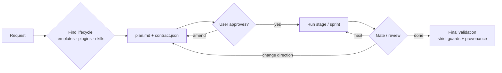
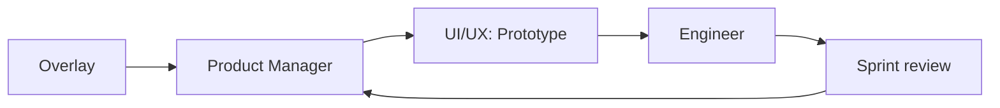

# 2026-10-15 — Harness refactor: plan and first delivery

Source: chat session of 2026-10-15. Decision: [D-048](../decisions/decision_log.md). Tracker: `N34`.

## Issues raised by the user

- Loop guard blocks edits of `feature_list.json` even when no development runs.
- One `feature_list.json`, `progress.txt` and `tracker.json` per session assumes one ask per session.
- Those files drift from the `plan.md` the user keeps editing; check alignment before each run.
- Visual evidence and test results land in the workspace root.
- Skills are often not picked up; the initial contract should list expected skills, hooks, plugins and MCPs, and provenance should compare it with facts.
- Guards are too restrictive: after a number of trips, ask the user whether to keep a guard or lay it down for the session; strict again for final validation.
- Delivery agents should route to the right templates and plugins, explain trade-offs concisely, track expected vs actual in the contract and report it in one line each.
- The creator builds everything in one flow; real projects change direction. Show the plan, skills and agent workflow with milestones and check-ins.

## Plan v1 (first response)

Root causes found:
- `hooks/loop_guard.py` matched `PROTECTED` against the whole tool-input JSON, so any edit whose content mentioned `tracker.json` or `feature_list.json` was denied; it also kept protecting after every feature passed (it only checked that `state.json` exists).
- `tools/loop/loop.py` refuses `init` when `.harness/state.json` exists (one loop per folder); about 60 `project / ".harness"` joins across 12 files, no path helper.
- Skills come only from prompt ranking or static `HARNESS_REQUIRED_SKILLS`; nothing ties them to a plan.
- Guards only deny; only `budget.py` uses `ask`; no session waiver.

Target layout: `.hve/asks/active.json`; `.hve/asks/<slug>/{plan.md, contract.json, feature_list.json, progress.txt, tracker.json, design.json, state/}` with `state/` replacing `.harness/`.

Phases:
- Phase 0: branch `harness-refactor/mm-1015`, baseline tests.
- Phase A (demo): A1 loop guard path-only matching and release after the loop; A2 `tools/loop/asks.py` (start, migrate, sync, note); A3 `contract.json` schema (workflow, milestones, expected skills/templates/plugins/hooks/MCPs/domain, decisions, plan hash); A4 routing data; A5 planner and delivery-guide agents; A6 `hooks/usage_log.py`.
- Phase B: B1 move every `.harness`/root join onto the helper; B2 `loop.py amend` via `feature_list.add.json`; B3 milestone builder; B4 `hooks/guard_policy.py` waivers after N trips, strict while an evaluation run is open, never for escalation/bypass/push; B5 `hooks/plan_sync.py` and `plan_changed` in `next`/`verify`; B6 skill loader loads contract skills; B7 provenance `contract` component.
- Phase C: build, tests, wiki, decision log, tracker, version, VSIX.

Decisions: contract as sibling `contract.json` (feature list schema untouched); loop files under `.hve/` are no longer committed; legacy layout fails fast with an explicit `migrate`; guards stay, only their surfacing changes.

User answers: fix both guard bugs; build all agents; sibling `contract.json`; move files under `.hve` now (later deferred).

## Plan v2 (agents revised by the user)

The user replaced planner, delivery guide and milestone builder with three agents built on the creator. Planning became step 0 of each, routing became the lifecycle picker, milestones became stage gates or sprint reviews.

| Agent | Base | Lifecycle | Verification | Output |
|---|---|---|---|---|
| E2E | creator | Picks one (e.g. SDLC) from templates/plugins, baked into the plan | Full: loop, guards, reflection | Working product + deliverables |
| Prototype | creator, stripped | None: screens → flows → clickthrough | Safety and security only | HTML/TS clickable prototype |
| Agile | creator | Overlay from templates/plugins: epics → sprints | Per sprint: feature checks; reflection at release | Increment per sprint |

Lifecycles live in `templates/lifecycles/*.json` (built-in), `plugins/<name>/lifecycles/*.json` and the workspace; `tools/loop/lifecycle.py` lists, picks and contracts them.

## Delivered (commits 61275ca..fe64f1c, extension 0.9.0)

| Item | Result |
|---|---|
| Loop guard fix | Edits matched by target path inside the project; shell commands only when they write; loop files released once all features pass; `.harness/` stays protected |
| HVE prototype | Clickthrough in `.hve/asks/<slug>/prototype/`; only the loop guard's safety checks |
| HVE e2e | Lifecycle pick → skip question → `plan.md` → stage-by-stage with gates (continue / change direction / stop) |
| HVE agile | Overlay with product-manager, prototype (UI/UX) and engineer personas; sprint reviews |
| HVE engineer (hidden) | Builds one feature to its check |
| Lifecycles | `sdlc`, `agile-scrum`, `consulting-delivery`; plugin and workspace overrides |
| Contract and provenance | `.hve/asks/<slug>/contract.json` (expected agent, skills, templates per stage, one-line decisions); `provenance.md` expected vs used |
| Skills | Current stage's skills load and are allowed |
| `loop.py amend` | Later milestones or sprints add features; locked ones never change |

Open after this delivery: loop files under `.hve/asks/<slug>/` (deferred by the user), guard waivers, `plan.md` drift check, provenance contract component.

## Follow-up (D-049, extension 0.10.0)

The user deferred the folder move and asked for the other three. Built: guard waivers after 3 trips with a `guard-waiver:<guard>` question (strict during output evaluation; `.harness/`, escalation, bypass, pushes never waivable); `lifecycle.py plan-sync` and `hooks/plan_check.py` (reconcile context on each prompt, loop and stage runs held while `plan.md` is out of sync); provenance `contract` component and `guards` summary from logged facts.
