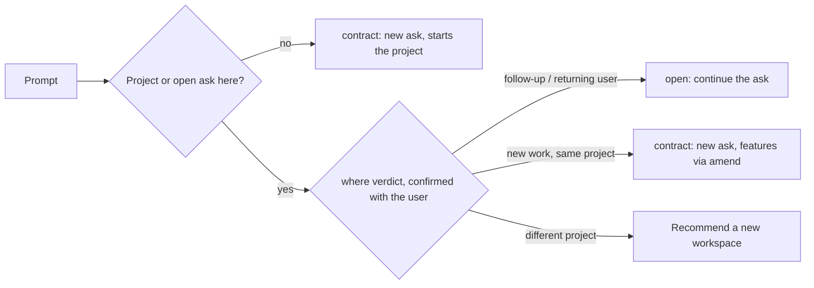

# Feedback: project level, continuation, agile loop, prototype check, renames

- **Feedback received:** 2026-10-21 16:58 UTC (live tests of the delivery agents, extension 0.14.0)
- **Decisions given:** 2026-10-21 17:26 UTC
- **Written:** 2026-10-21 18:56 UTC
- **Decision:** D-054 in `research/decisions/decision_log.md`
- **Built in:** extension 0.15.0

## Findings (user, verbatim in substance)

1. **Asks confused with each other.** When ask names are similar, one ask is mixed up with an earlier one. Agents should always use the ask's own paths (`asks/<id>/loop/`, `asks/<id>/plan.md`); searching for `plan.md` returns the first ask's file.
2. **Several asks over time.** A session may hold several asks, or a user may come back later. Does each return become a new ask?
3. **Shared project artefacts.** `feature_list.json`, `plan.md`, `progress.txt` and similar files are common to the project and should sit under `.hve/` directly, shared, rather than per ask. Each ask keeps its own evidence, loop records and tool log.
4. **Tool log missing.** The tool log is not written in some modes, such as agile and prototype.
5. **One workspace, one project.** Running Instagram, WhatsApp and Facebook projects in parallel sessions in one folder did not work. The harness should check the common project under `.hve/`, and recommend a separate workspace for a different project.
6. **Prototype declares success unchecked.** Prototype runs no loop, which is fine, but it builds once and declares everything good.
7. **Agile verified nothing.** Agile collected no evidence, wrote no tool log and ran no loop.
8. **Agent names.** Rename e2e to Frontier E2E Delivery, agile to Frontier BYOW, and prototype to Frontier Prototype Creator. Give each a detailed description with example uses:
   - e2e follows a template and runs long sessions;
   - agile has a lifecycle and overlays, is run by personas such as a product manager, checks in more often and builds step by step;
   - prototype is a fast clickthrough with no roles.

## Discussion (summary of the analysis given before any change)

| # | Cause found | Proposal |
|---|---|---|
| 1 | Ask folders never collide. Agents drift from the `paths` that `contract` printed once (worst after compaction) and search the workspace for `plan.md`. | Repeat the open ask's paths on every prompt and in every sub-agent; add `lifecycle.py where`; tell agents never to search. |
| 2 | Agents ran `contract` on every request, so a follow-up or a return visit opened a new ask. | Continue the open ask by default. Open a new ask only for new work. |
| 3 | Agreed, with one caveat. | Add a `.hve/project/` level for the feature list, progress, tracker and lock. Keep `plan.md` per ask, because the plan check, its hash and the sign-off checklist work per ask. Trade-off: features from an abandoned ask stay locked in the product list. |
| 4 | By design, the tool log feeds stuck-loop diagnosis, so it is written only while a feature is being built. | Optional per-session activity log for all agents. |
| 5 | The topic check compared a prompt only with the previous ask, so three apps looked like "new work of the same kind". | Anchor on `.hve/project/project.json` and compare with the project's goal, asks and features. A different project means a new-workspace recommendation. |
| 6 | Contradictory instructions:<br>- the overlay's `sprint-build` agent is `HVE engineer`;<br>- agile delegates a whole step to its agent;<br>- the engineer must not run `loop.py`.<br>So nobody ran the loop. | Engineer stages are feature loops the orchestrator runs, one engineer per feature. Check e2e's build stage too. |
| 7 | Nothing verifies a prototype. | Add a cheap self-check script plus screenshots, then the sign-off form with the screenshots as evidence. |
| 8 | Proposed "Frontier Agile Team (bring your own way of working)", and dropping "HVE" from every display name. | The user chose otherwise (see below). |



## User decisions (verbatim)

> for 1. the plan is also common across right or will it each ask implemnentation plan. which is fine for me as it clear and there is a central document or json which contains all the features across the project 2. yes i like the idea of continuation where the user can return to the session adn continue and new ask is created only when new work is happening. just confirm that with the user so it surfaces 3. agent ledger is enough. 4. yes good. 5. it is Frontier BYOW (Bring your own way of working). rename only what was suggested.

1. **Project level:** keep one implementation `plan.md` per ask, plus a central project feature list shared by all asks.
2. **Continuation:** a returning user or a follow-up continues the open ask, and a new ask opens only for new work. The agent confirms the choice with the user so that it surfaces.
3. **Activity log:** none. The agent ledger is enough.
4. **Prototype:** add the self-check script and screenshots.
5. **Names:** rename only these three:
   - Frontier E2E Delivery;
   - Frontier BYOW (Bring your own way of working);
   - Frontier Prototype Creator.

## What was built (0.15.0)

```
.hve/project/            project.json (name, goal, kind, asks), feature_list.json, feature_list.add.json,
                         progress.txt, tracker.json, state.json (lock records the ask that added each feature)
.hve/asks/<id>/          request, contract, plan.md, provenance, prototype/,
                         loop/ (attempts, evidence, prs, choices, checks, tool_log.jsonl)
```

- **Project level.** These modules follow the project layout when an ask is open:
  - `tools/loop/loop_paths.py`. This was an external edit, adopted here; it adds `project_folder`, `state_file` and `ask_evidence`.
  - `loop.py`, `loop_guard.py`, `flow.py`, `parallel_options.py` and `provenance.py`.

  How the layout behaves:
  - `loop.py init` locks each feature with its ask.
  - The tracker takes evidence from the ask that added each feature.
  - A second `init` fails, pointing to `feature_list.add.json` and `loop.py amend`.
  - The guard protects `.hve/project/` as loop state.
  - `tasks-sync` and the report's quality pillar count only the features this ask added.
  - With no ask open (research arms, `bench.py`), the layout is unchanged.
- **Anchor and continuation.** `contract` writes or extends `.hve/project/project.json` and returns `project`, including `loop`, which is `init` or `amend`. New commands and changes:
  - `lifecycle.py where [request-file]` prints the project, the open ask with its paths and unfinished items, and a verdict: `continue`, `new-ask`, `new-workspace` or `new-project`.
  - `lifecycle.py open <ask>` now prints the ask's paths, current milestone and open items.
  - Every ask-opening agent runs `where` first and confirms the verdict in one ask-questions form. `HVE single`, which never asks, follows the verdict.
- **Different project.** `topic_shift` compares a prompt with the project text (goal, every ask's request, feature names). It recommends a new workspace for:
  - a different kind of deliverable;
  - a create-verb prompt with at least three subject words sharing under 20% with the project.

  "New session" was removed.
- **Paths everywhere.** The skill loader adds the open ask's plan, evidence and feature-list paths to every prompt. The compaction hook gives every sub-agent the ask folder and evidence path. Agents are told never to search for `plan.md` or `feature_list.json`.
- **Agile and E2E verify again.**
  - A stage whose agent is `HVE engineer` is a feature loop the orchestrator runs itself, with one engineer per feature.
  - The engineer refuses a brief that hands it a whole stage.
  - Later sprints and later asks use `feature_list.add.json` and `loop.py amend`.
- **Prototype self-check.** `tools/prototype/check.py` has two commands:
  - `lint` checks for `index.html`. It flags external URLs, network calls, code built from strings and forms that submit. It also confirms that every named screen is present and every `#` link has a route or element id.
  - `shots` saves a headless Edge or Chrome screenshot of each route to the ask's `loop/evidence/prototype/`, and fails if no browser is installed.

  The agent fixes every problem before the sign-off form and shows the screenshots in it.
- **Renames.**
  - The display names and detailed descriptions with example uses changed for `hve-e2e`, `hve-agile` and `hve-prototype`. File ids are kept, so installs and exports still work.
  - The lifecycle JSON files (`agile-scrum` sprint-design and `consulting-delivery` build) now name `Frontier Prototype Creator`.
  - The wiki and tests were updated.

## Decisions to surface (not settled)

1. **The plan stays per ask and there is no `roadmap.md`.** `project.json` (with its asks) and the project feature list are the central record. A roadmap index was proposed but not built.
2. **Abandoned asks' features stay locked** in the project list. There is no retire status yet, and one would be a new loop rule.
3. **"New session" is gone.** The model is now one workspace, one project, so new work of the same kind becomes a new ask in the same workspace and is no longer told to use a new chat.
4. **Continuation is instruction-level.** Agents must run `where` and ask the user; nothing enforces it. A skipped `where` falls back to the old behaviour, a new contract, which `contract` and the skill loader still flag for a different project.
5. **Tool logs stay per ask** and are written only during feature loops. The agent ledger covers sub-agents (user decision 3).
6. **Prototype screenshots need a local Edge or Chrome**, launched headless with a temporary profile. Without one, `shots` fails loudly and the user reviews by hand. The lint is static and does not run the page's JavaScript.
7. **`where` verdict heuristics** reuse the subject-word overlap. A follow-up phrased very differently can be judged `new-ask`, but the user's answer in the form wins.
8. **Asks from 0.12 to 0.14 kept their loop files in `<ask>/loop/`.** The new layout reads `.hve/project/`, so a loop started under 0.14 has to be restarted or its files moved. No migration was built.
