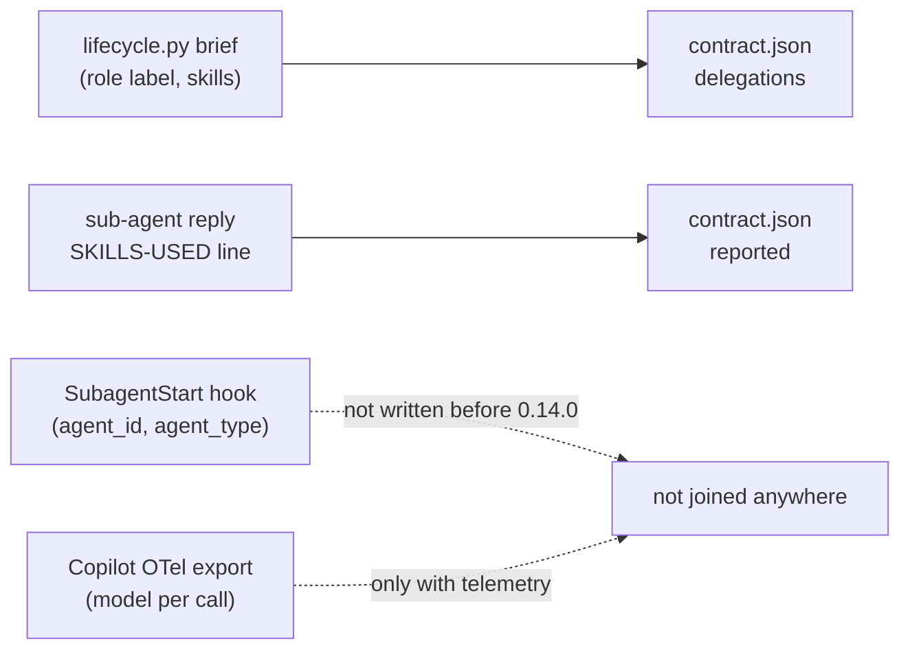
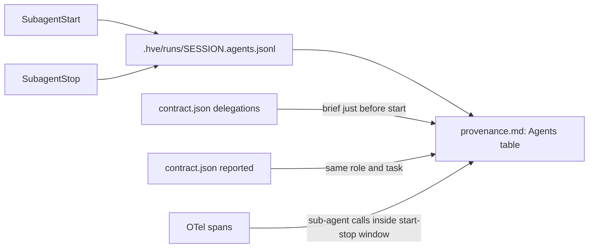
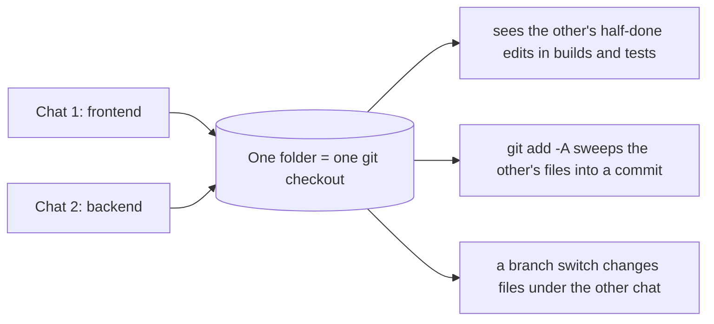

# Parallel sessions and the agent ledger (discussion, 2026-10-21)

Discussion with the user after the 0.13.0 live tests. Outcome: decision D-053, extension 0.14.0.

## 1. Tracking agents, sub-agents, skills and models

**Ask:** record each agent's and sub-agent's name (not just ids), the skills each sub-agent got, and the model, e.g. `agent id: 3434, session: 324234, agent: HVE e2e, model: astra, skills: [anti-slop]`.

**Was it already there?** Partly, but scattered and self-reported:



**Why not the tool log:** it exists only while a feature loop runs, holds one row per tool call, and feeds loop diagnosis. Prototype, product manager and document stages would be missing, and diagnosis would get noisier.

**Chosen:** an agent ledger per session, joined into an Agents table per ask.



Example row and table line:

```json
{"ts":"2026-10-21T06:15:02.120+00:00","session":"324234","ask":"20261021-0615-friendly","agent":"HVE e2e",
 "event":"start","agent_id":"3434","subagent":"HVE product-manager","model":null}
```

| Agent | Sub-agent | Id | Seconds | Brief: role, skills | Reported skills | Model |
|---|---|---|---|---|---|---|
| HVE e2e | HVE product-manager | 3434 | 212 | requirements PM: prd | prd | claude-x (OTel) |

**Limits:** VS Code and Copilot hook payloads carry no model, so the model is known only from Cursor or Codex payloads, or from OTel when research telemetry is on. Brief-to-sub-agent and sub-agent-to-OTel joins go by time, not ids.

## 2. Parallel sessions

**Ask:** how are parallel sessions handled today (one session on frontend, another on backend), with and without HVE agents? Can worktrees make it parallel?

### Today, without HVE



Different files are fine until either chat builds, commits or switches branch. Nothing records which chat did what.

### Today, with HVE (0.13.0)

```mermaid
sequenceDiagram
  participant C1 as Chat 1 (creator)
  participant H as .hve/asks/active.json
  participant G as git checkout
  participant C2 as Chat 2 (prototype)
  C1->>H: contract → ask A
  C2->>H: contract → refused while A is open (0.13.0)
  C1->>G: loop.py next → checkout feature/a
  Note over C1,C2: a second loop would switch the branch under chat 1;<br/>verify stops with "not on branch feature/a"
```

HVE's own records stay apart (ask folders, session logs). The git checkout cannot host two loops at once: that is git, not HVE.

### Options considered

| Option | Verdict |
|---|---|
| Worktree tooling (create worktree, copy `.hve` settings, open window) | Rejected: convoluted; a worktree already gets its own `.hve/` on first use, nothing needs copying |
| Per-chat ask binding in one folder (session → ask for every command) | Deferred: terminal commands cannot know their chat; still one git checkout |
| Refuse a new ask while one is open (0.13.0) | Reverted by the user: parallel asks should still get their own folder |
| **Own folder per ask, plus a one-time note to the displaced chat** | **Chosen (0.14.0)**, minimal |

### Chosen behaviour (0.14.0)

```mermaid
sequenceDiagram
  participant C1 as Chat 1 (creator)
  participant H as .hve/asks/active.json
  participant C2 as Chat 2 (prototype)
  C1->>H: contract → ask A (skill loader notes: chat 1 owns A)
  C2->>H: contract → ask B, own folder, previous_open = A
  C2-->>C2: tells user: A still open, parallel builds need separate folders
  C1->>C1: next tool call: "another chat opened B; run lifecycle.py open A"
  C1->>H: lifecycle.py open A
```

Recommended patterns, simplest first:

| Pattern | Example | Use when |
|---|---|---|
| One ask with parts | "Build the orders page and its API": features `api-orders`, `ui-orders` | One deliverable with frontend and backend parts |
| One folder per chat | `git worktree add ../shop-memo -b memo`, open in a new window | Two separate builds at the same time |
| Two chats, one folder | Prototype while creator plans | Light work (prototype, PRD) beside a build; never two feature loops |

## Open items

- Branch prefix per ask (`feature/<ask-slug>/<name>`) to avoid branch clashes across worktrees: optional, not built; it changes the branch names creator-github pushes.
- Learnings and user profile are per folder; a "sync learnings back" step was not requested.
- Verify live: SubagentStop fires on the parent agent in VS Code; Copilot ignores or accepts `SubagentStop` in `hve.json`.
